# Assignment 7 — Capstone: Deploy a Production-Grade Stack for The EpicBook

Part of the DevOps Micro Internship (DMI) with Agentic AI

---

## Purpose

In this assignment, I deployed the EpicBook application as a production-oriented Docker Compose stack on a cloud VM. I used optimized container images, isolated networks, health checks, persistent MySQL storage, a selected reverse proxy, logging, backup and restore testing, and reliability procedures.

---

# Task 0 — App Discovery and Architecture

## Goal

Review the EpicBook repository and design the intended application architecture.

### Evidence

#### Screenshot 1 — EpicBook Project Structure

Add a terminal screenshot showing the EpicBook project structure after cloning the repository.

<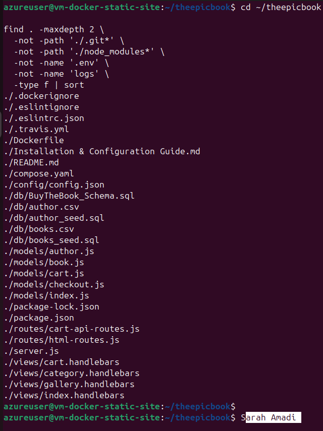>

---

#### Screenshot 2 — Architecture Diagram

Add a screenshot of your architecture diagram showing:

- Public user
- Reverse proxy
- Frontend
- Backend
- Database
- Docker networks
- Public and private ports
- Persistent database storage

Add your full name inside the diagram or as a clear caption below it.

<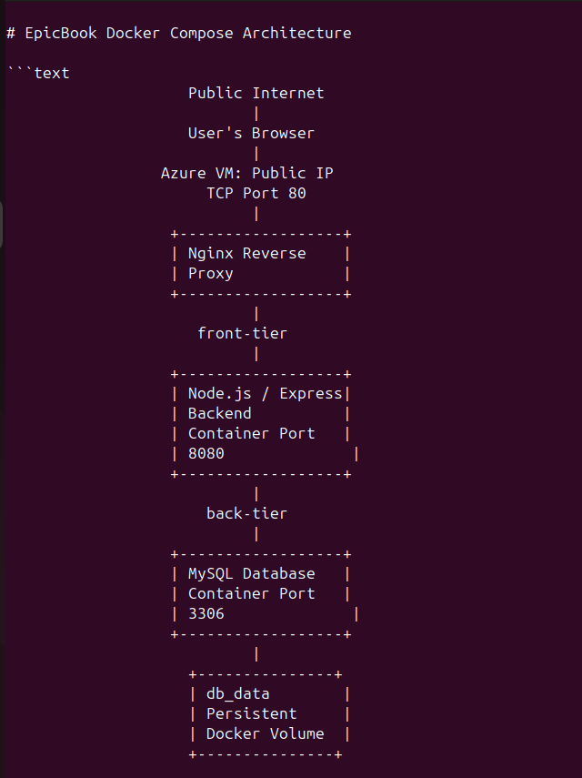>
<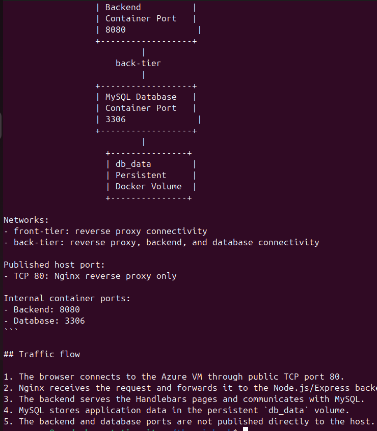>

---

#### Screenshot 3 — Environment Variables and Ports Document

Add a screenshot showing the contents of:

```text
docs/02-env-and-ports.md
```

It must document environment-variable names, internal ports, persistent-data details, and the health-check method. Do not expose real credentials or values.

<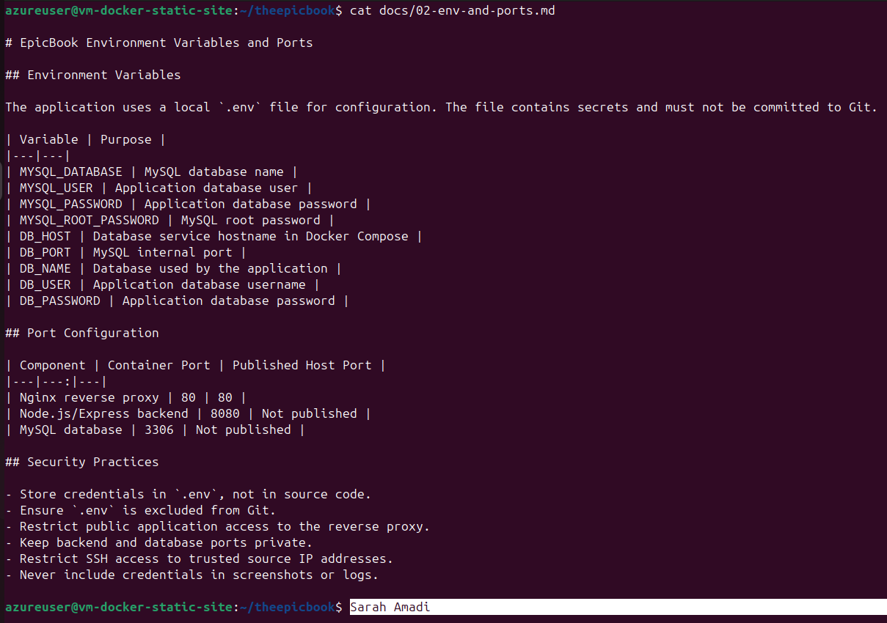>

---

# Task 1 — Create Production Docker Images

## Goal

Create optimized production images for the EpicBook backend and frontend.

### Evidence

#### Screenshot 4 — Backend Dockerfile

Add a screenshot showing `backend/Dockerfile`, including:

- Dependency stage
- Minimal runtime stage
- Production startup command
- Internal backend port
- Non-root user configuration

<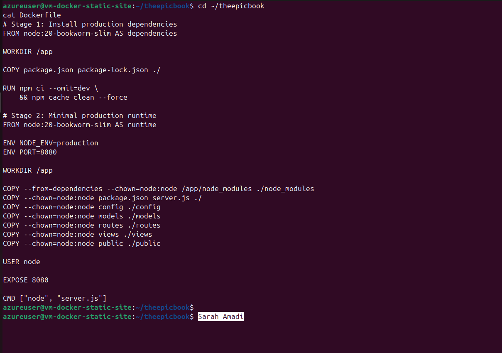>

---

#### Screenshot 5 — Frontend Dockerfile

Add a screenshot showing `frontend/Dockerfile`, including:

- Nginx runtime image
- Static frontend files copied to the Nginx web root

<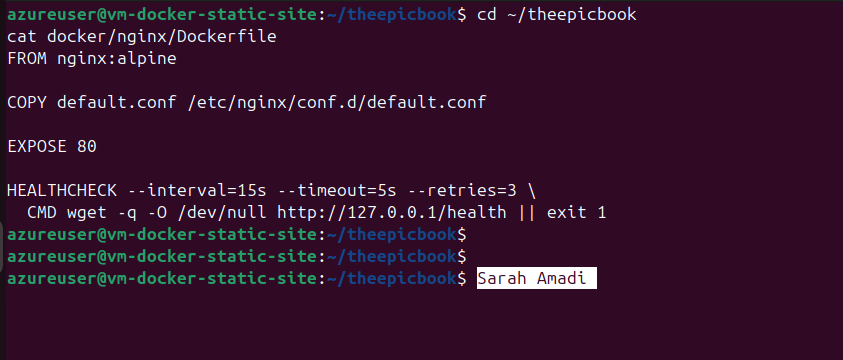>

---

#### Screenshot 6 — Docker Ignore Files

Add a screenshot showing both:

```text
backend/.dockerignore
frontend/.dockerignore
```

<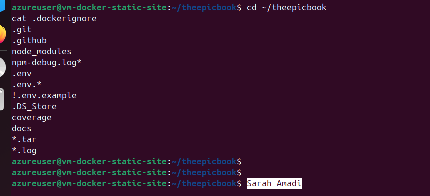>

---

#### Screenshot 7 — Docker Image Builds and Size Comparison

Add a terminal screenshot showing successful builds of:

- Baseline backend image
- Optimized backend image
- Frontend image

The screenshot must also show the baseline and optimized backend image-size comparison.

<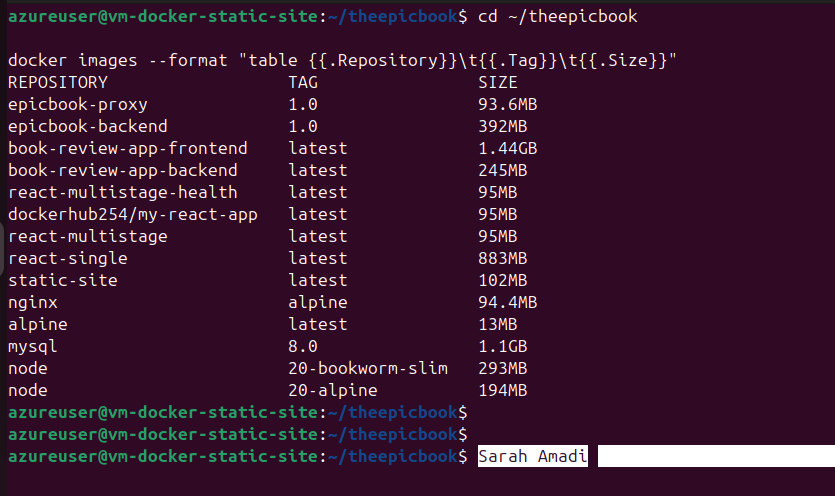>

---

#### Screenshot 8 — Backend Running as Non-Root User

Add a terminal screenshot showing the optimized backend container running as a non-root user.

<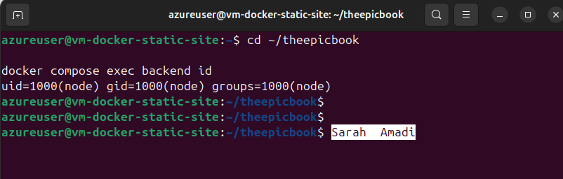>

---

### Notes

Write a short note covering:

### Baseline and optimized backend image sizes
### The image-size reduction achieved


### One Docker layer-caching optimization used

The Dockerfile copies package.json and package-lock.json and installs production dependencies before copying application source code. This allows Docker to reuse the dependency layer when only application code changes.

### The security benefit of running the backend as a non-root user

Running the backend as the node user (UID 1000) instead of root reduces the potential impact of a compromised application by limiting its privileges inside the container.


---

# Task 2 — Create the Docker Compose Stack and Networks

## Goal

Create one Docker Compose stack containing the reverse proxy, frontend, backend, and MySQL database.

### Evidence

#### Screenshot 9 — Docker Compose Services

Add a screenshot showing `docker-compose.yml` with all four services:

```text
reverse-proxy
frontend
backend
database
```

<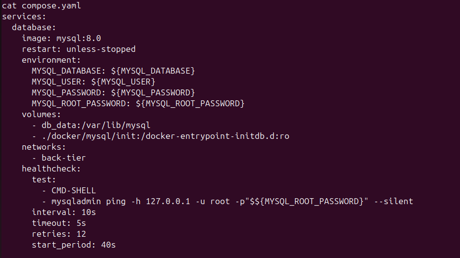>

<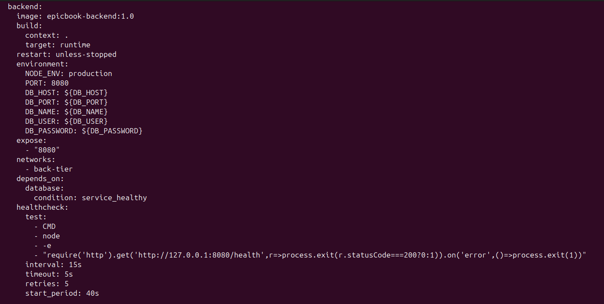>

<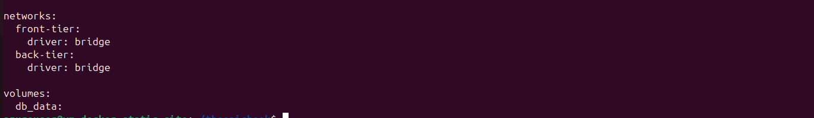>

---

#### Screenshot 10 — Networks and Named Volume

Add a screenshot showing:

- `front-tier` network
- `back-tier` network
- `db_data` named volume

<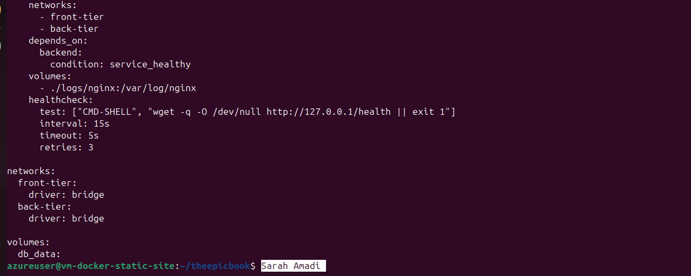>
<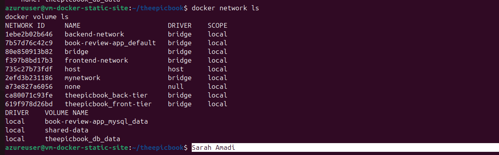>
---

#### Screenshot 11 — Docker Compose Validation

Add a terminal screenshot showing successful Docker Compose validation without exposing environment-variable values or secrets.

<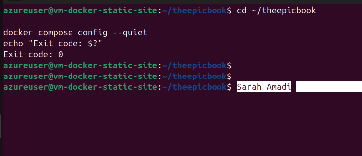>

---

# Task 3 — Configure Health Checks and Startup Dependencies

## Goal

Configure health checks and ensure services start only after their dependencies are healthy.

### Evidence

#### Screenshot 12 — Backend Health Endpoint

Add a screenshot showing the backend application configuration for the `/health` endpoint.

<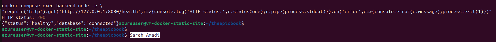>

---

#### Screenshot 13 — MySQL and Backend Health Checks

Add a screenshot showing `docker-compose.yml` with health checks for MySQL and the backend.

<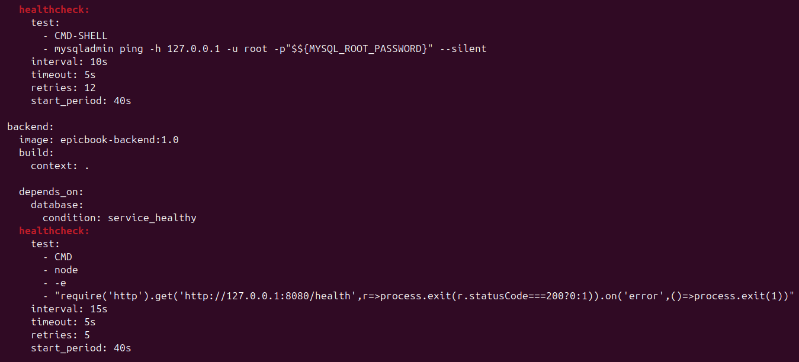>
<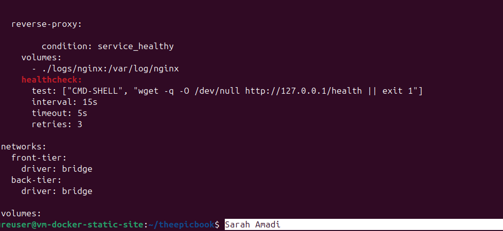>

---

#### Screenshot 14 — Frontend and Reverse-Proxy Health Checks

Add a screenshot showing:

- Frontend health check
- Reverse-proxy health check
- `depends_on` conditions using `service_healthy`

<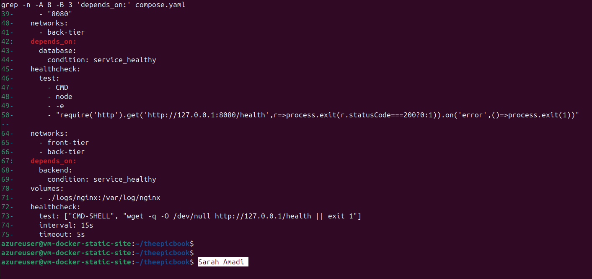>

---

#### Screenshot 15 — Running Healthy Services

Add a terminal screenshot showing Docker Compose service status. The database, backend, frontend, and reverse proxy must be running successfully.

<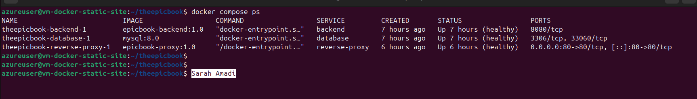>

---

#### Screenshot 16 — Public Health Endpoint

Add a terminal screenshot showing a successful response from the public application health endpoint through the reverse proxy.

<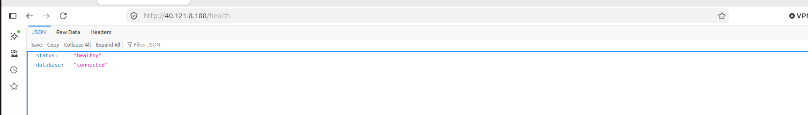>

---

#### Screenshot 17 — Health-Check and Startup-Order Document

Add a screenshot showing the contents of:

```text
docs/03-healthchecks-and-depends-on.md
```

Explain the health-check method for each service and the startup dependency order.

<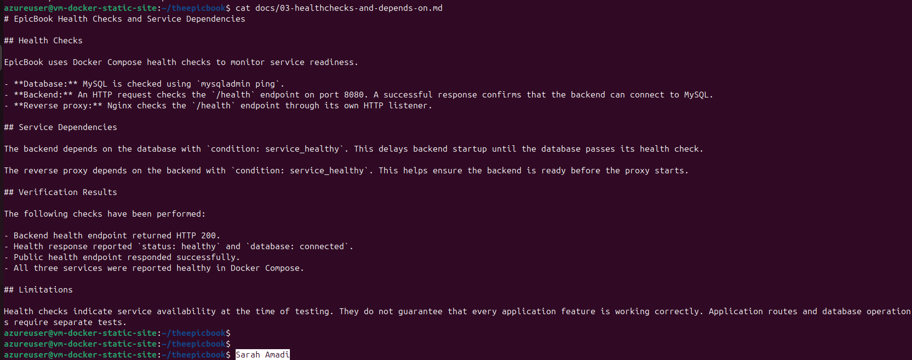>

---

# Task 4 — Configure the Reverse Proxy and Same-Origin Routing

## Goal

Use either Nginx or Traefik as the only public entry point for the EpicBook application.

### Evidence

#### Screenshot 18 — Selected Reverse-Proxy Configuration

Add a screenshot showing the configuration for your selected reverse proxy.

It must show routes for:

- Static frontend assets
- Application pages
- API requests
- Health endpoint

<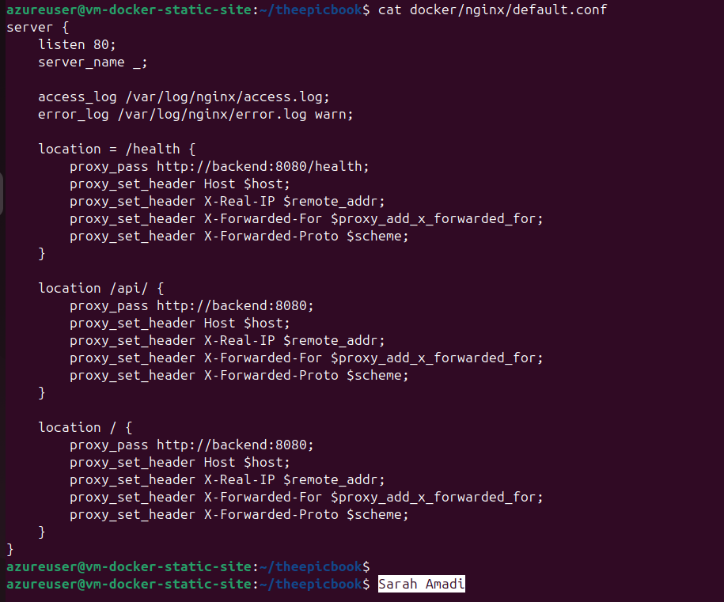>

---

#### Screenshot 19 — Only Reverse Proxy Publishes Port 80

Add a screenshot of `docker-compose.yml` showing that only the `reverse-proxy` service publishes port 80.

<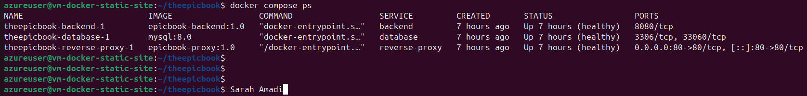>

---

#### Screenshot 20 — Reverse-Proxy Route Testing

Add a terminal screenshot showing successful requests through the selected reverse proxy to:

- Application page
- One API endpoint
- One static asset
- Health endpoint

<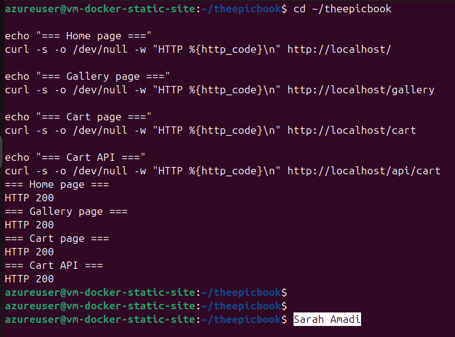>

---

#### Screenshot 21 — EpicBook Application Through Public IP

Add a browser screenshot showing the EpicBook application loaded through the VM public IP address.

Add your full name as a clear caption below the screenshot.

<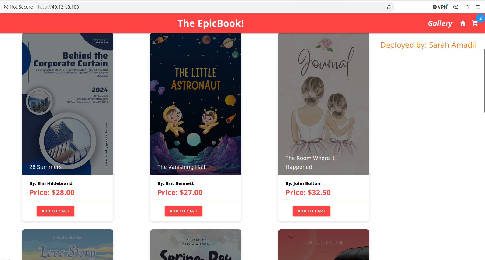>

---

#### Screenshot 22 — Proxy Routing and CORS Document

Add a screenshot showing the contents of:

```text
docs/04-proxy-routing-and-cors.md
```

Explain the proxy routes and state whether CORS was required and why.

<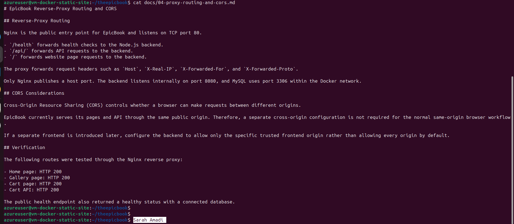>

---

# Task 5 — Prove Data Persistence, Backup, and Restore

## Goal

Verify MySQL persistence and perform a controlled backup and restore drill.

### Evidence

#### Screenshot 23 — MySQL Volume Configuration

Add a terminal screenshot showing the `db_data` named volume and its MySQL mount configuration.

<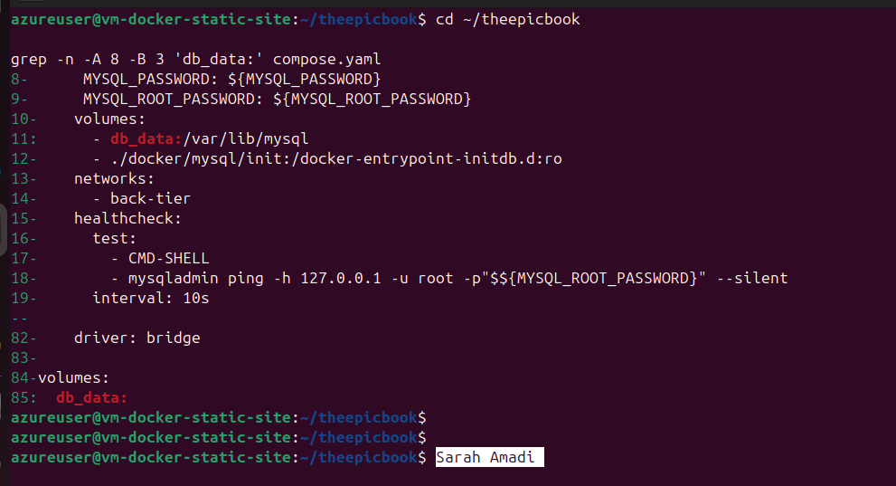>

---

#### Screenshot 24 — Test Data Before Backup

Add a terminal screenshot showing the selected test data before the backup and restore drill.

<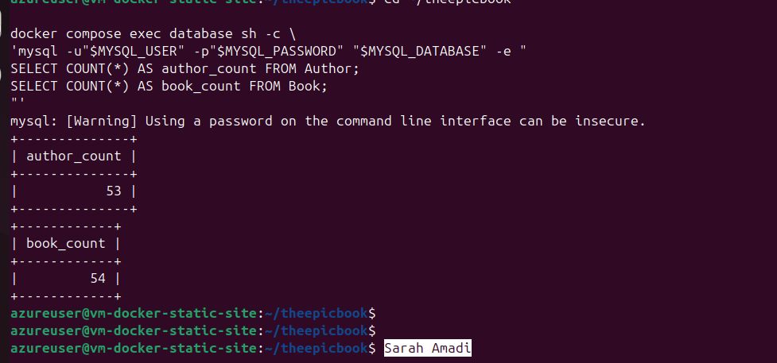>

---

#### Screenshot 25 — Successful Backup Creation

Add a terminal screenshot showing successful backup creation and the backup file stored in the host backup directory.

<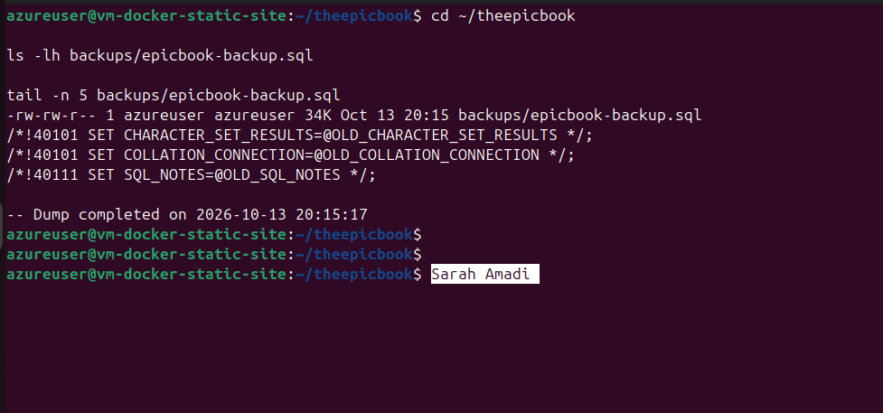>

---

#### Screenshot 26 — Controlled Data-Loss Test

Add a terminal screenshot showing that the selected test record was removed during the controlled data-loss test.

<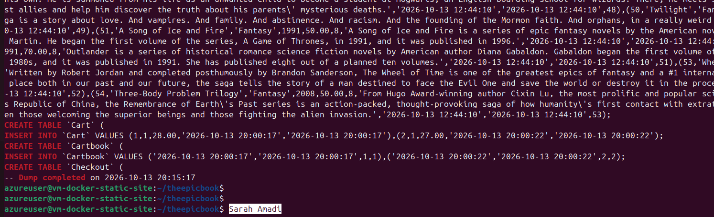>
<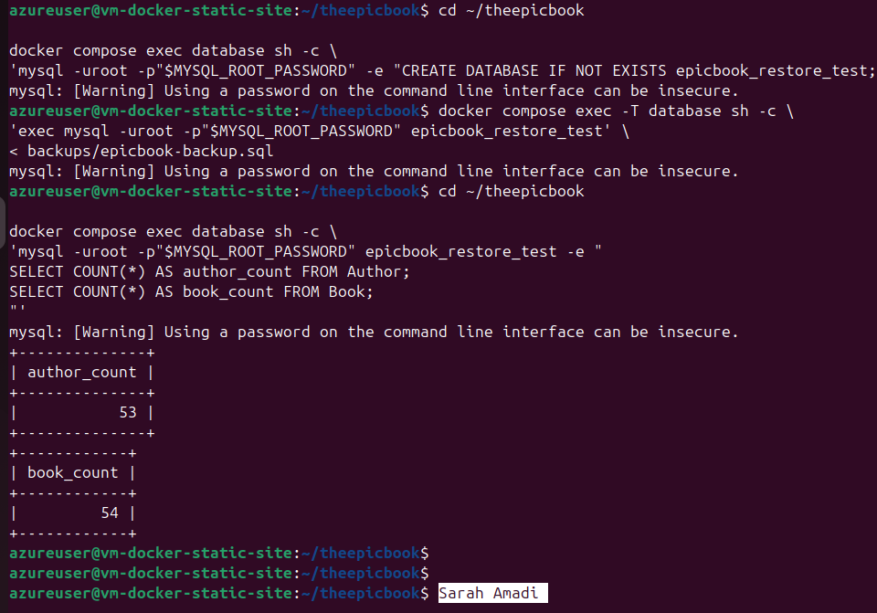>

---

#### Screenshot 27 — Restore Verification

Add a terminal screenshot showing successful restore and verification that the deleted test record is available again.

<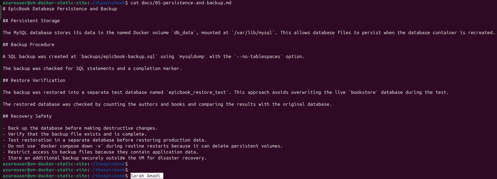>

---

#### Screenshot 28 — Persistence After Down/Up Cycle

Add a terminal screenshot showing that database data remains available after a non-destructive Docker Compose down/up cycle.

Do not use `docker compose down -v`.

<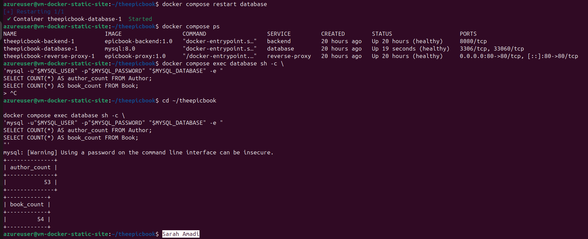>

---

#### Screenshot 29 — Persistence and Backup Document

Add a screenshot showing the contents of:

```text
docs/05-persistence-and-backup.md
```

Include the backup plan and restore procedure.

<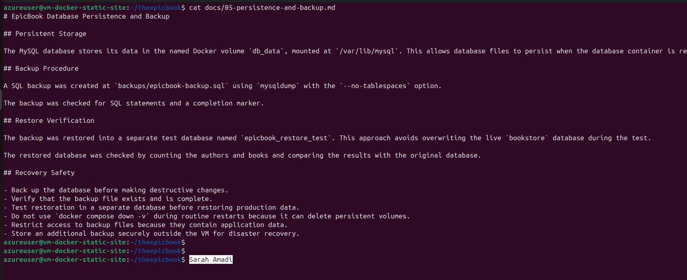>

---

# Task 6 — Configure Logging and Observability

## Goal

Configure useful reverse-proxy and backend logs without exposing sensitive information.

### Evidence

#### Screenshot 30 — Logging Configuration

Add a screenshot showing:

- Configuration for the selected reverse proxy
- Proxy log format
- Docker Compose host log-directory bind mount

<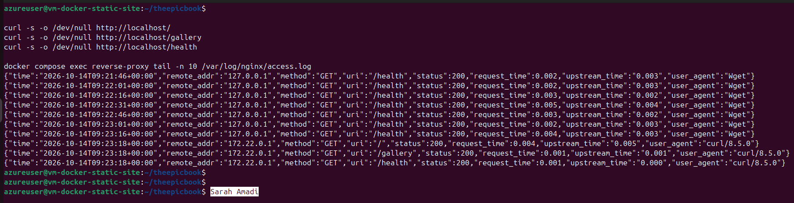>

---

#### Screenshot 31 — Persistent Proxy Logs and Backend Logs

Add a terminal screenshot showing:

- Selected reverse-proxy logs available from the host directory after a proxy restart
- Backend logs displayed through Docker Compose

<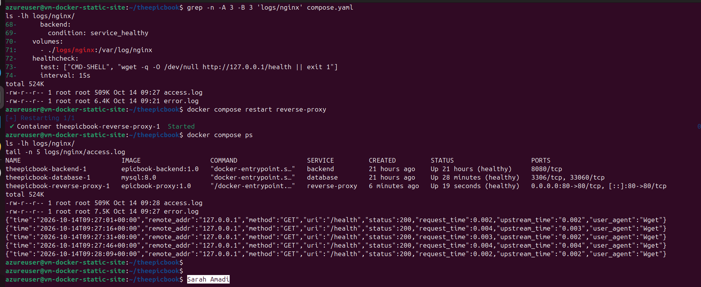>

---

### Notes

Write a short note covering:

- The selected reverse proxy
- Host path used for reverse-proxy logs
- How backend logs are viewed
- Whether JSON or standard text logs were used
- Why passwords, tokens, headers, and database connection strings must not appear in logs

### EpicBook Logging Configuration

**Reverse proxy:** Nginx is used as the reverse proxy to route incoming HTTP requests to the Node.js backend.
**Host log path:** Reverse-proxy logs are persisted on the VM under `~/theepicbook/logs/nginx/`, with `access.log` and `error.log` files mounted into the container at `/var/log/nginx/`.
**Backend logs:** View application output using `docker compose logs backend`. To follow new entries, use `docker compose logs -f backend`.
**Log format:** JSON structured access logs are configured for Nginx. They record request metadata such as timestamps, request paths, HTTP status codes, and response times. The error log uses Nginx's standard error-log format.
**Security:** Passwords, tokens, authorization headers, cookies, and database connection strings must never appear in logs. Logs can be stored for long periods or accessed by other administrators. Exposing secrets in them could allow unauthorized access to the application or database. Log only the information needed for troubleshooting, and restrict access to log files.

---

# Task 7 — Deploy and Verify the Stack on a Cloud VM

## Goal

Deploy the completed Docker Compose stack on an AWS or Azure VM and verify public access.

### Evidence

#### Screenshot 32 — VM Public IP and Inbound Rules

Add a cloud-console screenshot showing:

- VM public IP address
- SSH port 22 restricted to your IP address
- HTTP port 80 allowed from Anywhere

<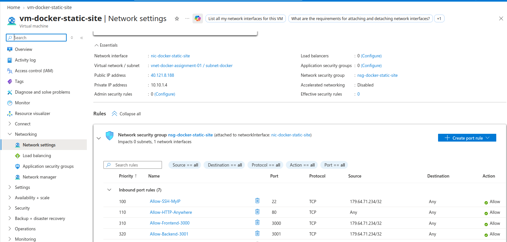>

---

#### Screenshot 33 — Cloud VM Stack Verification

Add a VM terminal screenshot showing:

- Docker Compose service status
- Successful public health or API response
- No published database, frontend, or backend ports

<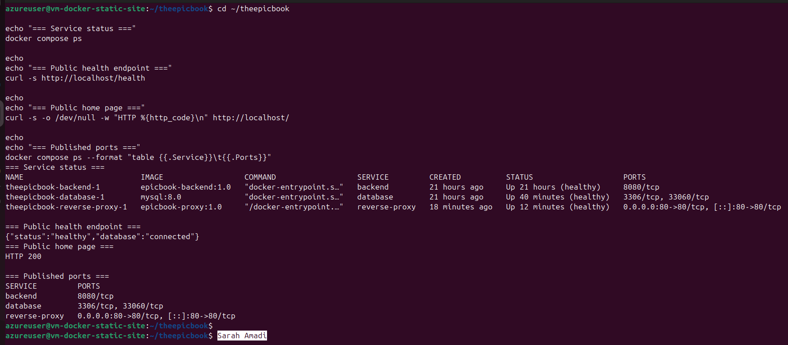>

---

#### Screenshot 34 — EpicBook Application on Cloud VM

Add a browser screenshot showing the EpicBook application loaded through the VM public IP address.

Add your full name as a clear caption below the screenshot.

<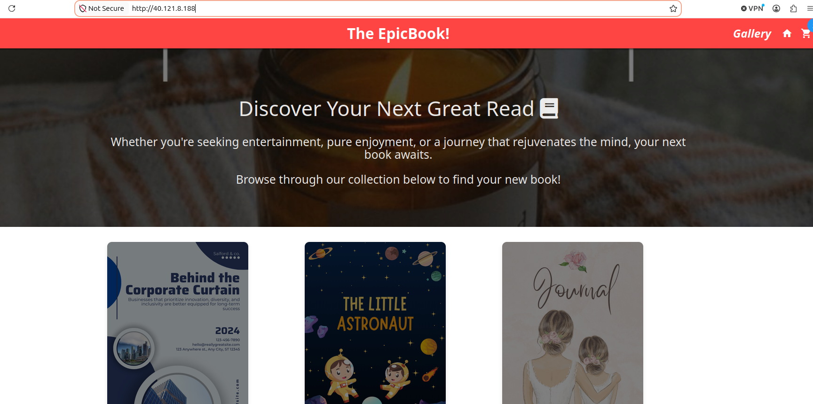>

---

### Notes

Write a short note covering:

- Cloud provider used
- VM operating system
- Public port exposed
- Security rules configured
- Confirmation that the application and backend API worked through the reverse proxy

### EpicBook Cloud Deployment and Security

- **Cloud provider:** Microsoft Azure.
- **VM operating system:** Ubuntu Linux 24.04.
- **Public port exposed:** TCP port 80, used by the Nginx reverse proxy to receive HTTP traffic.
- **Security rules:** SSH access on TCP port 22 is restricted to a trusted public IP address. HTTP port 80 is open to the internet to allow access to the website. Backend port 8080 and MySQL port 3306 are not published to the host or exposed through public inbound rules.
- **Application verification:** The EpicBook homepage, gallery, cart page, and cart API returned HTTP 200 through Nginx. The public health endpoint also confirmed that the backend was healthy and connected to the MySQL database.

This deployment demonstrates how Azure VM hosting, Docker Compose networking, Nginx reverse-proxy routing, and restricted port exposure work together to provide public application access while keeping backend services private.

---

# Task 8 — Automate Deployment with CI/CD (Optional)

## Goal

Optionally automate image build, image push, and deployment through GitHub Actions or Azure Pipelines.

### Optional Evidence

#### Optional Screenshot — Successful CI/CD Pipeline Run

Add a screenshot showing a successful pipeline run with build, image push, deployment, and verification stages.


---

### Optional Notes

Write a short note covering:

- CI/CD platform used
- Image-tagging method
- Registry used
- Deployment trigger
- Manual approval or secret-handling approach


---

# Task 9 — Perform Reliability Tests and Create an Operations Runbook

## Goal

Test controlled service failures and document safe operating procedures.

### Evidence

#### Screenshot 35 — Backend Failure and Recovery

Add a terminal screenshot showing:

- Backend failure test
- Expected unavailable response through the reverse proxy
- Backend restart
- Successful health-check recovery

<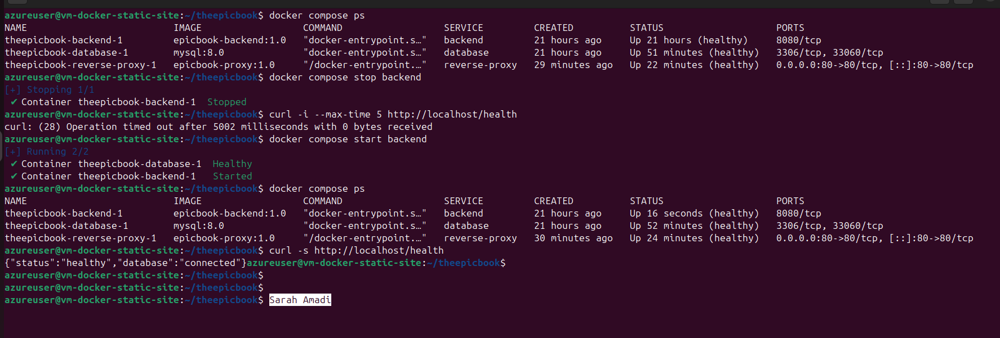>

---

#### Screenshot 36 — Database Failure and Recovery

Add a terminal screenshot showing:

- Database outage test
- Failed database-dependent request
- Database restart
- Successful application recovery

<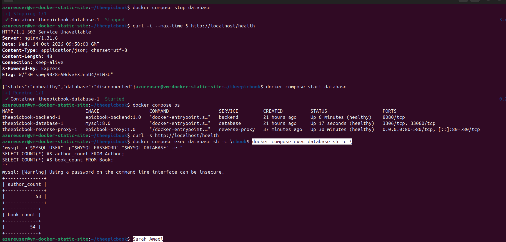>

---

### Notes

Write a short operations runbook covering:

- Safe restart procedure for reverse proxy, frontend, backend, and database
- Backup and restore procedure
- Secret-rotation approach
- Database recovery procedure
- What to check when the application returns an error
- Results of backend and database reliability tests

# EpicBook Operations and Recovery Runbook

## 1. Safe Restart Procedure

First, inspect the service status:

```bash
docker compose ps
```

Restart only the affected service to minimize disruption:

- **Reverse proxy (Nginx):** `docker compose restart reverse-proxy`
- **Frontend:** EpicBook uses server-side-rendered Handlebars pages, so it does not have a separate frontend container. The pages are served by the backend through Nginx.
- **Backend (Node.js/Express):** `docker compose restart backend`
- **Database (MySQL):** `docker compose restart database`

After restarting, verify service health:

```bash
docker compose ps
curl -s http://localhost/health
```

The expected health response is:

```json
{"status":"healthy","database":"connected"}
```

## 2. Database Backup and Restore

### Backup

Create a protected backup directory and export the database:

```bash
mkdir -p backups
chmod 700 backups

docker compose exec -T database sh -c \
'exec mysqldump --no-tablespaces -u"$MYSQL_USER" -p"$MYSQL_PASSWORD" "$MYSQL_DATABASE"' \
> backups/epicbook-backup.sql
```

Verify the backup file exists and ends with a dump completion marker:

```bash
ls -lh backups/epicbook-backup.sql
tail -n 5 backups/epicbook-backup.sql
```

Store another copy securely outside the VM.

### Restore

Test the backup in a separate database first. For production restoration, back up the current database before replacing any data and verify the target database carefully.

Restore using the appropriate authorized MySQL account:

```bash
docker compose exec -T database sh -c \
'exec mysql -u"$MYSQL_USER" -p"$MYSQL_PASSWORD" "$MYSQL_DATABASE"' \
< backups/epicbook-backup.sql
```

**Warning:** Restoring a full dump into an existing database can overwrite or conflict with existing objects and records. Use a controlled recovery plan and a verified backup before restoring production data.

## 3. Secret Rotation

1. Generate new, strong database credentials.
2. Update the MySQL and application configuration consistently.
3. Apply the credential change using an authorized database administrator.
4. Recreate the affected services so they use the updated configuration.
5. Verify `/health` reports a connected database.
6. Never commit `.env` files or expose credentials in logs, screenshots, or source control.

For production use, prefer a managed secret store and a documented credential-rotation procedure.

## 4. Database Recovery

If the database becomes unavailable:

1. Check `docker compose ps`.
2. Inspect database logs with `docker compose logs --tail=100 database`.
3. Check available disk space and database health.
4. Restart the database if appropriate:

   ```bash
   docker compose restart database
   ```

5. Wait for the database health check to pass.
6. Verify the backend health endpoint and important record counts.
7. If recovery fails, preserve the existing volume and investigate before attempting a restore.

Never use `docker compose down -v` during routine recovery because it can delete the persistent database volume.

## 5. Application Error Troubleshooting

When the application returns an error, check the following:

- **Service status:** `docker compose ps`
- **Backend logs:** `docker compose logs --tail=100 backend`
- **Database logs:** `docker compose logs --tail=100 database`
- **Proxy logs:** Inspect `logs/nginx/access.log` and `logs/nginx/error.log`.
- **Health endpoint:** `curl -i http://localhost/health`
- **Routing:** Confirm Nginx forwards `/`, `/gallery`, `/cart`, `/api/`, and `/health` to the backend.
- **Connectivity:** Verify the backend can authenticate to MySQL.
- **Configuration:** Check environment-variable names and service hostnames without printing secret values.

A `503` from `/health` can indicate that the backend cannot connect to the database. Use the service logs and health checks to identify the cause before restarting components.

## 6. Reliability Test Results

### Backend failure test

The backend was stopped and subsequently restarted. The intended verification was to observe the failure through the health endpoint, restart the backend, and confirm recovery.

### Database failure test

The database was stopped. The health endpoint returned `HTTP 503 Service Unavailable` with the status `unhealthy` and database status `disconnected`.

The database was restarted successfully. All three Compose services subsequently reported healthy, and the database retained **53 authors and 54 books**.

### Persistence and backup verification

A database backup completed successfully using `mysqldump --no-tablespaces`. The backup was restored into a separate test database, and the live database retained its data after a database-container restart.

These tests demonstrate successful database failure detection, recovery, and persistence in the tested environment. They do not by themselves establish production-grade availability or disaster-recovery guarantees.

---

# Final Public Application URL

**EpicBook URL:** http://40.121.8.188/

Replace the placeholder with your working public URL.

---

# GitHub Repository URL

**Your Fork or Repository URL:** https://github.com/sarah254-tech/theepicbook

---

# LinkedIn Requirement

## Goal

Create a professional LinkedIn post of 6–10 lines about your EpicBook capstone deployment.

Your post must include:

- The architectural decision that most improved reliability
- Your biggest image-size reduction, with numbers
- Key production-hardening lessons
- A deployment verification image

### Evidence

**LinkedIn Post URL:** https://www.linkedin.com/posts/sarah-w-amadi_devops-microsoftazure-docker-share-7516093978547646464-Awyr/?utm_source=share&utm_medium=member_desktop&rcm=ACoAACAx4n8Bvuf305sZ28vfr5yvaoLLEr0SkSA

#### LinkedIn Post Screenshot

<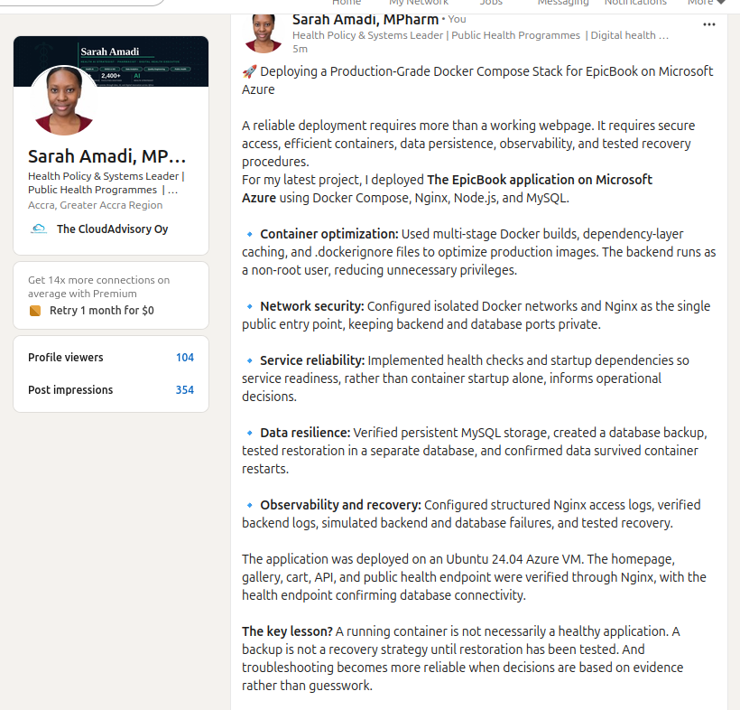>

---

# Submission Checklist

- [ ] EpicBook repository reviewed and architecture diagram created
- [ ] Environment variables, ports, persistence, and health-check details documented
- [ ] Backend and frontend production Dockerfiles created
- [ ] Backend runs as a non-root user
- [ ] Docker image-size comparison completed
- [ ] Docker Compose stack includes reverse proxy, frontend, backend, and database
- [ ] `front-tier` and `back-tier` networks configured
- [ ] `db_data` named volume configured
- [ ] MySQL, backend, frontend, and reverse-proxy health checks configured
- [ ] Startup dependencies use `service_healthy`
- [ ] Nginx or Traefik selected as the only public reverse proxy
- [ ] Only reverse-proxy port 80 is publicly published
- [ ] Same-origin routing configured and CORS used only when required
- [ ] Backup, restore, and persistence testing completed
- [ ] Reverse-proxy and backend logs verified
- [ ] Cloud VM deployment verified through the public IP
- [ ] Backend and database reliability tests completed
- [ ] Screenshots 1–36 included
- [ ] Required notes completed
- [ ] LinkedIn post URL and screenshot included
- [ ] Full name visible in required screenshots or captions
- [ ] No passwords, tokens, private keys, account IDs, or other sensitive information exposed

---

## 📌 About DMI & CloudAdvisory

DevOps Micro Internship (DMI) is a project-based DevOps program run by Pravin Mishra (The CloudAdvisory) focused on real-world execution, systems thinking, and career readiness.

It helps learners build strong DevOps foundations with hands-on experience.

---

## 📌 Resources

- 🌐 DMI Official Website: https://dmi.pravinmishra.com?utm_source=github&utm_medium=readme  
- 🎓 University: https://university.pravinmishra.com?utm_source=github&utm_medium=readme  
- 💬 Discord Community: https://discord.pravinmishra.com?utm_source=github&utm_medium=readme  
- 📝 Blog: https://dmi.pravinmishra.com/blog?utm_source=github&utm_medium=readme  
- ▶️ YouTube Playlist: https://www.youtube.com/playlist?list=PLFeSNDtI4Cho  
- 🔗 Pravin Mishra (LinkedIn): https://www.linkedin.com/in/pravin-mishra-aws-trainer/  
- 🏢 CloudAdvisory (LinkedIn): https://www.linkedin.com/company/thecloudadvisory/

---

*This submission is part of DevOps Micro Internship (DMI) — Agentic AI Track.*
