# Assignment 5 — Kubernetes Health Probes (Readiness)

Part of the DevOps Micro Internship (DMI) with Agentic AI

---

## Purpose

In this assignment, I configured and tested a Kubernetes readiness probe. I created a baseline NGINX Deployment, added an HTTP readiness probe, intentionally broke it, observed a stalled rollout, and restored the working configuration.

You will also demonstrate how readiness probes protect rolling updates.

---

# Task 0 — Prepare the Lab Environment

## Goal

Confirm that you are connected to your learning cluster and remove the previous assignment’s HPA and NGINX Deployment before starting this lab.

No screenshot or written notes are required for this pre-check.

---

# Task 1 — Set Up Your Lab Directory

## Goal

Create and enter a dedicated directory for the readiness-probe lab.

### Evidence

#### Screenshot 1 — Terminal showing that you are working inside `~/k8s-labs/health-probes-readiness`

<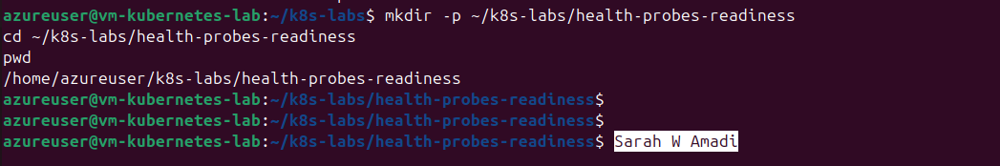>

---

### Notes

**1. What is the purpose of a readiness probe?**

A readiness probe checks whether a container is ready to receive application traffic. Kubernetes uses the result to decide whether the Pod should receive traffic through Services.

**2. Why is a Pod being Running not always enough to confirm it can serve traffic?**

Running only means the container has started. The application inside may still be initializing, experiencing problems, or unable to respond to requests.

---

# Task 2 — Create a Baseline Deployment Without Probes

## Goal

Create a baseline NGINX Deployment with two replicas and no readiness probe.

### Evidence

#### Screenshot 2 — Completed `00-nginx-deploy-baseline.yaml` manifest

<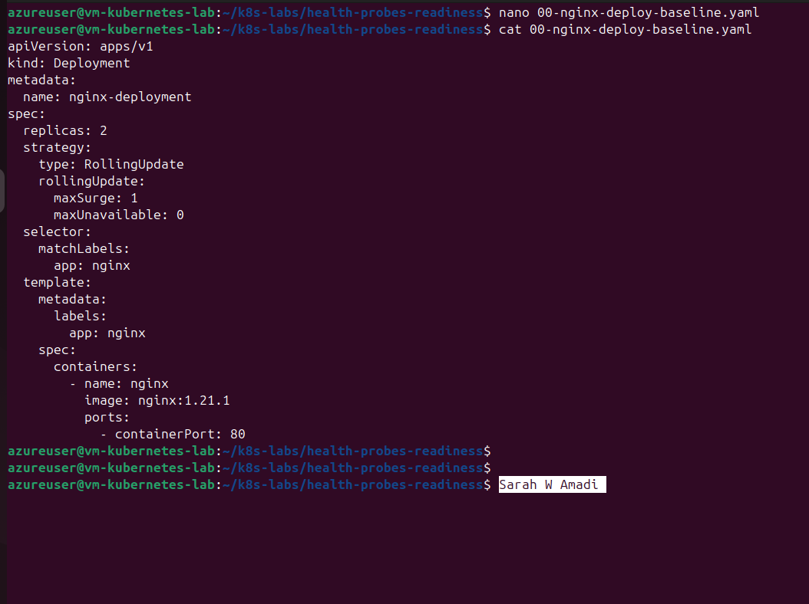>

---

#### Screenshot 3 — Output showing a successful rollout and two running NGINX Pods

<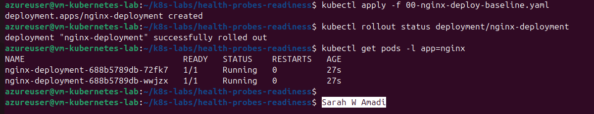>

---

#### Screenshot 4 — Relevant output from `kubectl describe deployment nginx-deployment`

<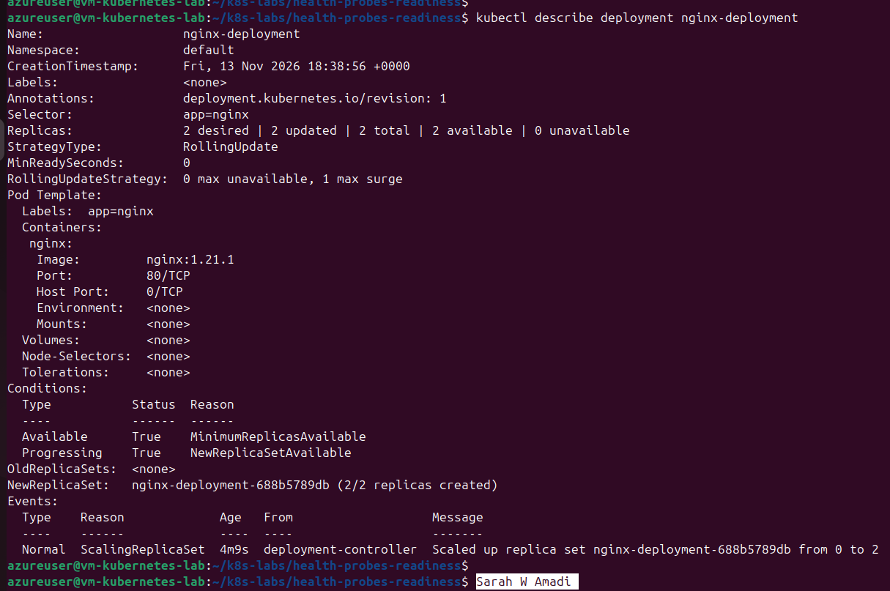>

---

### Notes

**1. How many replicas does this Deployment maintain?**

Two replicas, meaning Kubernetes maintains two NGINX Pods.

**2. What does `maxUnavailable: 0` mean during a rolling update?**

It means Kubernetes should not allow the number of available replicas to fall below the desired replica count during a rolling update.

**3. Is a readiness probe configured in this baseline Deployment?**

No. This baseline Deployment does not contain a readiness probe. Kubernetes therefore uses the container's normal readiness condition rather than checking a specific application endpoint.

---

# Task 3 — Add a Readiness Probe

## Goal

Add an HTTP readiness probe so Kubernetes checks whether each NGINX container is ready to accept requests.

### Evidence

#### Screenshot 5 — Completed `01-nginx-deploy-readiness.yaml` manifest showing the readiness probe

<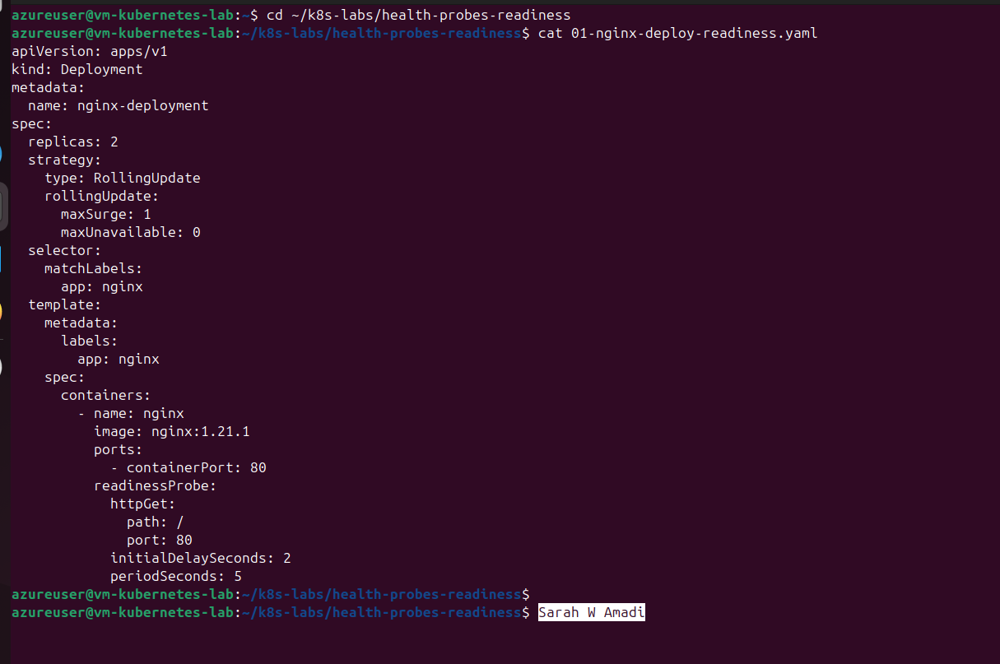>

---

#### Screenshot 6 — Output of the successful rollout and ready Pods

<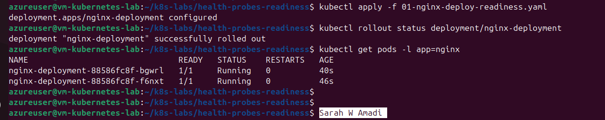>

---

#### Screenshot 7 — Pod description showing readiness conditions and readiness probe details

<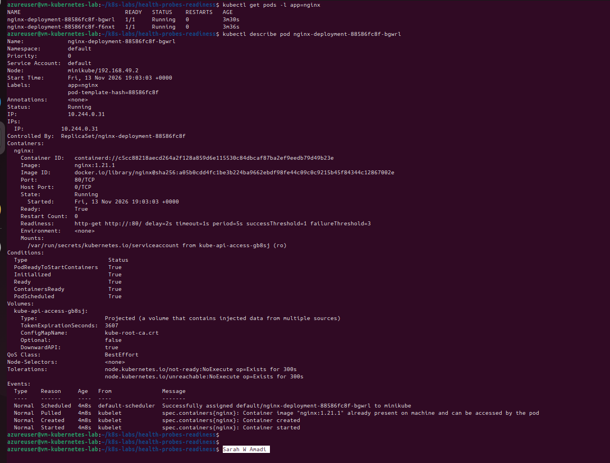>

---

### Notes

**1. What path and port does the readiness probe check?**

It checks the HTTP root path / on port 80.

**2. What does `initialDelaySeconds: 2` do?**

It waits two seconds after the container starts before performing the first readiness check.

**3. What does `periodSeconds: 5` do?**

It tells Kubernetes to perform the readiness check every five seconds.

**4. What must happen before Kubernetes considers this Pod ready?**

The HTTP request to the configured endpoint must return a successful response. For this NGINX configuration, the root path should return HTTP 200.

---

# Task 4 — Break and Restore Readiness

## Goal

Intentionally fail the readiness probe, observe the NotReady behavior, and then restore the working probe configuration.

### Evidence

#### Screenshot 8 — `02-nginx-readiness-broken.yaml` showing `/does-not-exist`

<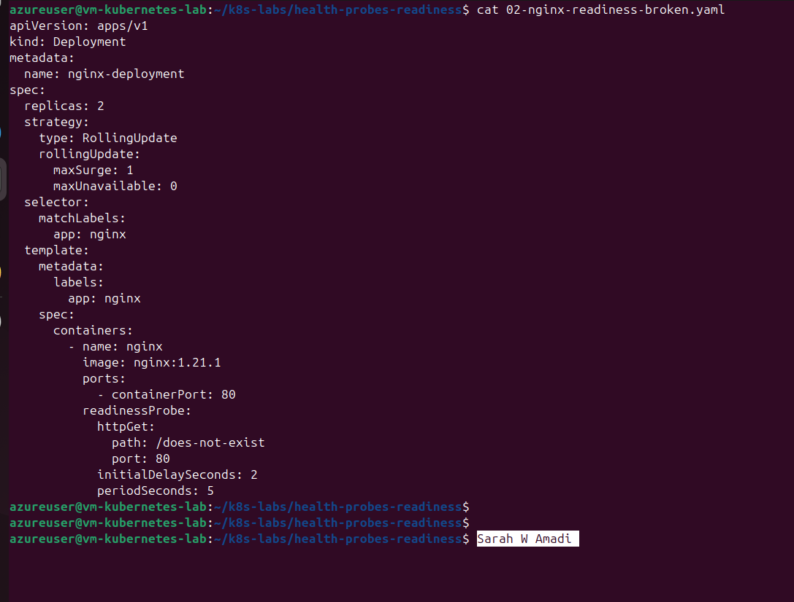>

---

#### Screenshot 9 — Output showing the rollout timeout or incomplete rollout

<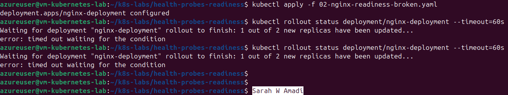>

---

#### Screenshot 10 — Pod details showing `Ready: False` or readiness-probe failure events

<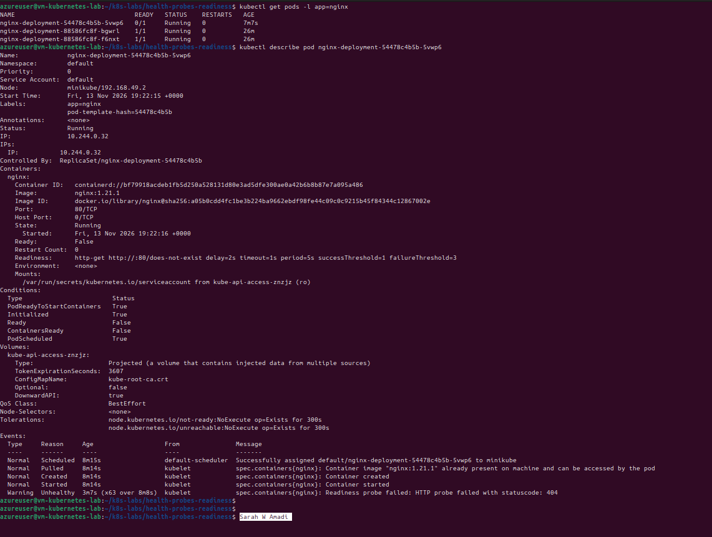>

---

#### Screenshot 11 — Output showing successful rollout and ready Pods after the fix

<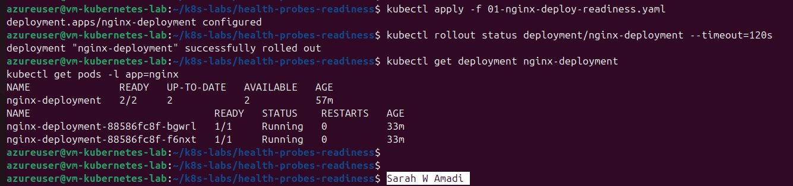>

---

### Notes

**1. Why did the readiness probe fail?**

The probe failed because it checked /does-not-exist, which is not a valid NGINX page. The server returned HTTP 404 instead of a successful response.

**2. What happened to the Pod readiness status?**

The new Pods remained NotReady because they could not pass the configured HTTP readiness check.

**3. Why did the rollout fail to complete?**

The Deployment could not mark the new Pods as available. With maxUnavailable: 0, Kubernetes retained the existing healthy Pods rather than removing them before replacements became ready.

**4. How did you restore the Deployment successfully?**

I reapplied the working readiness configuration with the correct / HTTP path, allowing the new Pods to pass their readiness checks and the rollout to complete.

---

# Task 5 — See How Readiness Protects Rolling Updates

## Goal

Observe how readiness prevents a bad new Pod from replacing healthy Pods during a rolling update.

### Evidence

#### Screenshot 12 — Successful update command and rollout status

<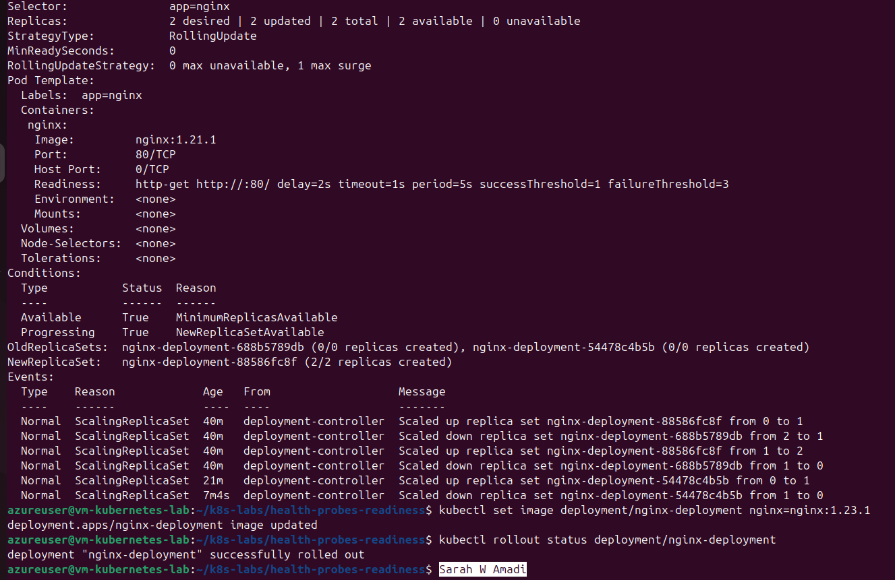>

---

#### Screenshot 13 — ReplicaSets and Pods after the successful rolling update

<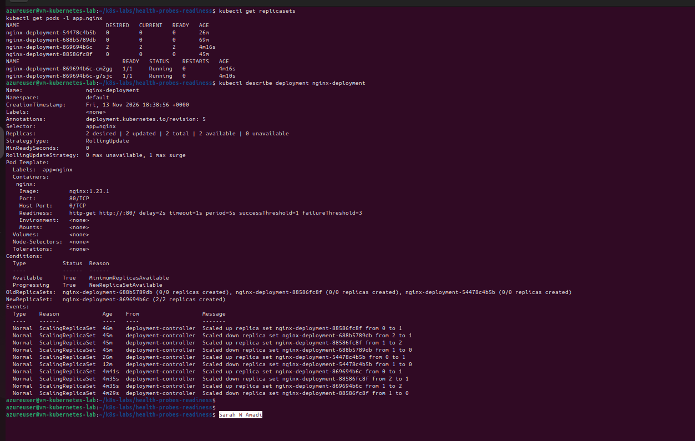>

---

#### Screenshot 14 — Completed `04-readiness-broken-patch.yaml`

<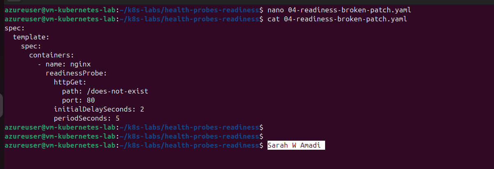>

---

#### Screenshot 15 — Output showing the expected stalled rollout or timeout

<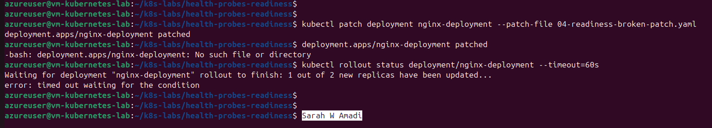>

---

#### Screenshot 16 — Deployment or Pod output showing the effect of the broken readiness probe

<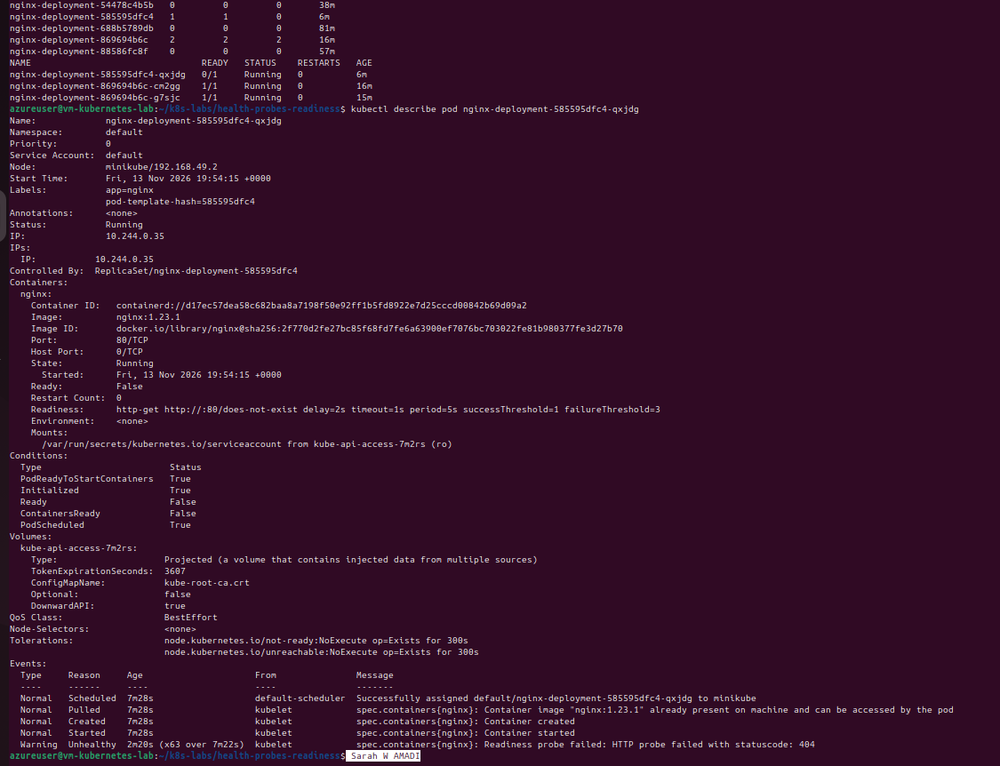>

---

#### Screenshot 17 — Successful rollout status after restoring the fixed configuration

<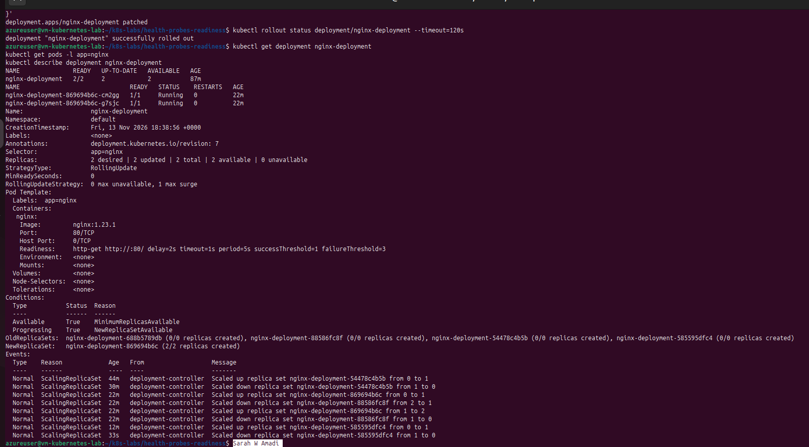>

---

### Notes

**1. What happened during the successful rolling update?**

Kubernetes created new Pods using the updated NGINX image, checked their readiness, and gradually replaced the previous Pods after the new Pods became ready.

**2. Why did Kubernetes create a new ReplicaSet?**

A change to the Deployment's Pod template, such as updating the container image, creates a new ReplicaSet to manage Pods with the updated configuration.

**3. Why were the new Pods unable to replace the existing healthy Pods after readiness was broken?**

The new Pods failed their readiness checks and were not considered available. Kubernetes therefore retained the existing healthy Pods.

**4. How does `maxUnavailable: 0` protect availability during this rollout?**

It prevents Kubernetes from reducing the number of available replicas below the desired count during the rolling update.

---

# Task 6 — Share Your Readiness-Probe Learning on LinkedIn

## Goal

Share what you learned about Kubernetes readiness probes and how they protect rolling updates.

### Evidence

#### Screenshot 18 — Published LinkedIn post

#### Linkedin post link

---

# Submission Instructions

- Add all required screenshots numbered 1–18.
- Ensure your full name is visible in required screenshots.
- Use clear, readable screenshots showing the relevant manifest or output.
- Include the completed baseline and readiness-probe manifests in your repository.
- Answer all Notes questions for Tasks 1–5 in your own words.
- Include evidence of the intentional readiness failure and successful recovery.
- Do not expose tokens, passwords, kubeconfig files, account IDs, or other sensitive information.

---

# Completion Checklist

- [ ] Learning cluster confirmed and previous assignment resources removed where applicable
- [ ] Readiness-probe lab directory created (Screenshot 1)
- [ ] Baseline Deployment created successfully (Screenshot 2)
- [ ] Two baseline Pods running and successful rollout verified (Screenshot 3)
- [ ] Baseline Deployment details reviewed (Screenshot 4)
- [ ] Readiness probe added successfully (Screenshot 5)
- [ ] Successful readiness rollout verified (Screenshot 6)
- [ ] Pod readiness conditions and probe details inspected (Screenshot 7)
- [ ] Broken readiness configuration created (Screenshot 8)
- [ ] Stalled rollout or timeout observed (Screenshot 9)
- [ ] NotReady status or readiness-probe failure events captured (Screenshot 10)
- [ ] Working readiness configuration restored (Screenshot 11)
- [ ] Successful image update completed (Screenshot 12)
- [ ] ReplicaSets and Pods inspected after the update (Screenshot 13)
- [ ] Broken-readiness patch created (Screenshot 14)
- [ ] Stalled rollout observed after the patch (Screenshot 15)
- [ ] Effect of broken readiness captured (Screenshot 16)
- [ ] Final recovery completed (Screenshot 17)
- [ ] LinkedIn post published (Screenshot 18)
- [ ] Notes for Tasks 1–5 completed
- [ ] Required manifests included
- [ ] All screenshots are clear and readable
- [ ] No sensitive data exposed

---

## 📌 About DMI & CloudAdvisory

DevOps Micro Internship (DMI) is a project-based DevOps program run by Pravin Mishra (The CloudAdvisory) focused on real-world execution, systems thinking, and career readiness.

It helps learners build strong DevOps foundations with hands-on experience.

---

## 📌 Resources

- 🌐 DMI Official Website: https://dmi.pravinmishra.com?utm_source=github&utm_medium=readme  
- 🎓 University: https://university.pravinmishra.com?utm_source=github&utm_medium=readme  
- 💬 Discord Community: https://discord.pravinmishra.com?utm_source=github&utm_medium=readme  
- 📝 Blog: https://dmi.pravinmishra.com/blog?utm_source=github&utm_medium=readme  
- ▶️ YouTube Playlist: https://www.youtube.com/playlist?list=PLFeSNDtI4Cho  
- 🔗 Pravin Mishra (LinkedIn): https://www.linkedin.com/in/pravin-mishra-aws-trainer/  
- 🏢 CloudAdvisory (LinkedIn): https://www.linkedin.com/company/thecloudadvisory/

---

*This submission is part of DevOps Micro Internship (DMI) — Agentic AI Track.*
