# Assignment 8 — Kubernetes Services (NodePort)

Part of the DevOps Micro Internship (DMI) with Agentic AI

---

## Purpose

Created a healthy NGINX Deployment, exposed it through a NodePort Service, tested access using a node IP and NodePort, and observed how the Service behaves when a backend Pod is replaced.

---

# Task 1 — Set Up Your Lab Directory

## Goal

Create and enter a dedicated directory for the NodePort Service lab.

### Evidence

#### Screenshot 1 — Terminal showing that you are working inside `~/k8s-labs/services/nodeport`

<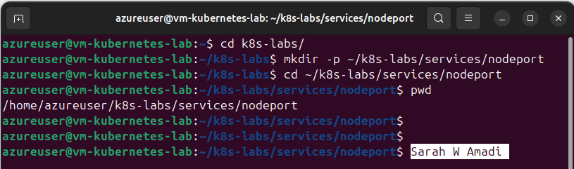>

### Notes

**1. What is the difference between ClusterIP and NodePort?**

- ClusterIP: Exposes a Service internally within the Kubernetes cluster. It is the default Service type.

- NodePort: Exposes a Service through a specific port on each cluster node, allowing access from outside the cluster when network access permits.

**2. What does a NodePort Service allow users to do?**

It allows users to access an application through a node's IP address and an assigned port, without needing to connect directly to individual Pod IP addresses.

---

# Task 2 — Create a Healthy NGINX Deployment

## Goal

Create a healthy NGINX Deployment that can act as the backend for the NodePort Service.

### Evidence

#### Screenshot 2 — Completed `00-nginx-deploy.yaml` manifest

<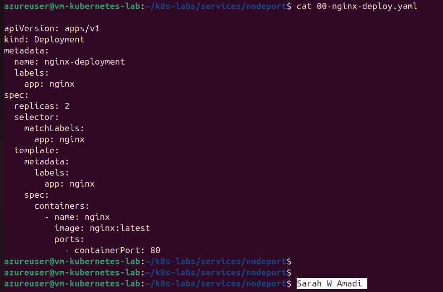>

---

#### Screenshot 3 — Output showing successful rollout and two ready NGINX Pods

<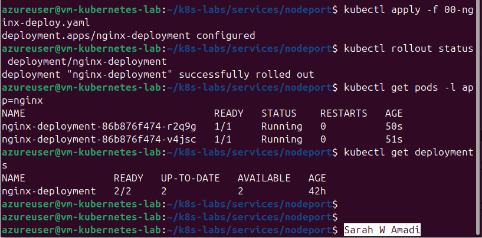>

### Notes

**1. Which label will the NodePort Service use to find the NGINX Pods?**

app: nginx

**2. Why must the Pods be ready before they can receive Service traffic?**

Kubernetes uses readiness information to determine which Pods are suitable to receive traffic. Unready Pods are excluded from the Service's ready endpoints.

**3. What port does the NGINX container listen on?**

Port 80.

---

# Task 3 — Create the NodePort Service

## Goal

Create a NodePort Service that exposes the NGINX application through a port on every cluster node.

### Evidence

#### Screenshot 4 — Completed `01-nginx-svc-nodeport.yaml` manifest

<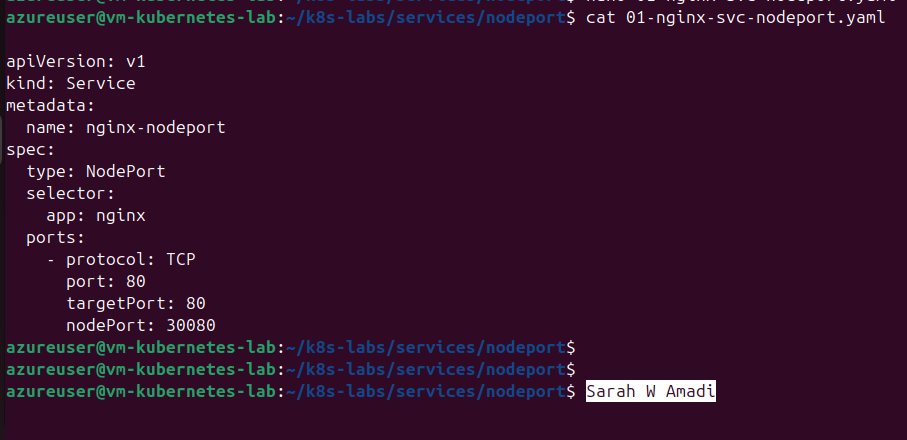>

---

#### Screenshot 5 — Output showing the NodePort Service and its endpoints or EndpointSlices

<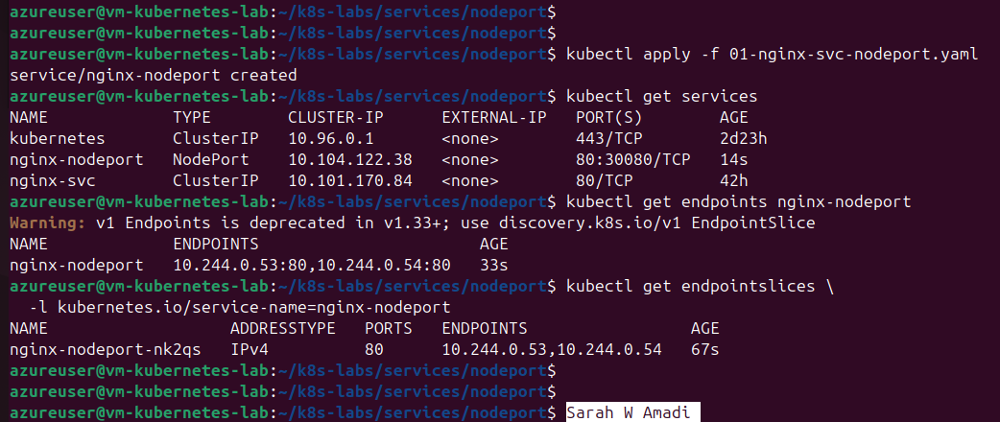>

### Notes

**1. What is the purpose of `type: NodePort`?**

It exposes a Kubernetes Service on a specific port across the cluster nodes, allowing access through a node IP and that port.

**2. What is the difference between `port`, `targetPort`, and `nodePort`?**

- port: Service's internal port.

- targetPort: Port on the backend container.

- nodePort: Port exposed on each cluster node.

**3. What NodePort was assigned or selected in your environment?**

30080 (the port selected in my YAML manifest).

**4. Why do Service endpoints need ready Pods?**

Only ready backend Pods should receive normal Service traffic. If a Pod is not ready, it is excluded from the ready endpoints.

---

# Task 4 — Find a Node IP and Test the NodePort

## Goal

Find a reachable node IP and access the NodePort Service.

### Evidence

#### Screenshot 6 — Output of `kubectl get nodes -o wide`

<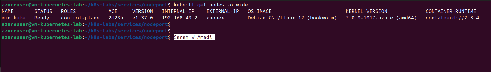>

---

#### Screenshot 7 — Output showing the `tester` Pod running

<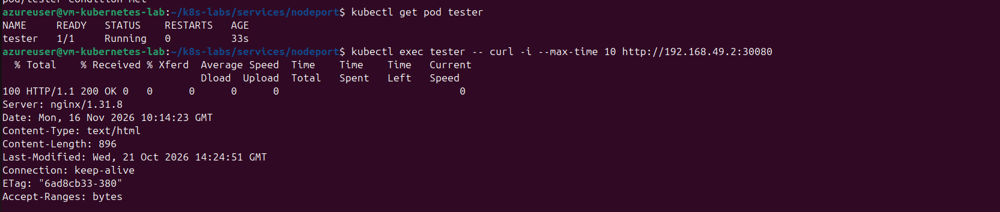>

---

#### Screenshot 8 — Successful NodePort response from the laptop or the `tester` Pod

If neither route is supported by your environment, include the failed request output and ready endpoint evidence, and explain the limitation in your Notes.

<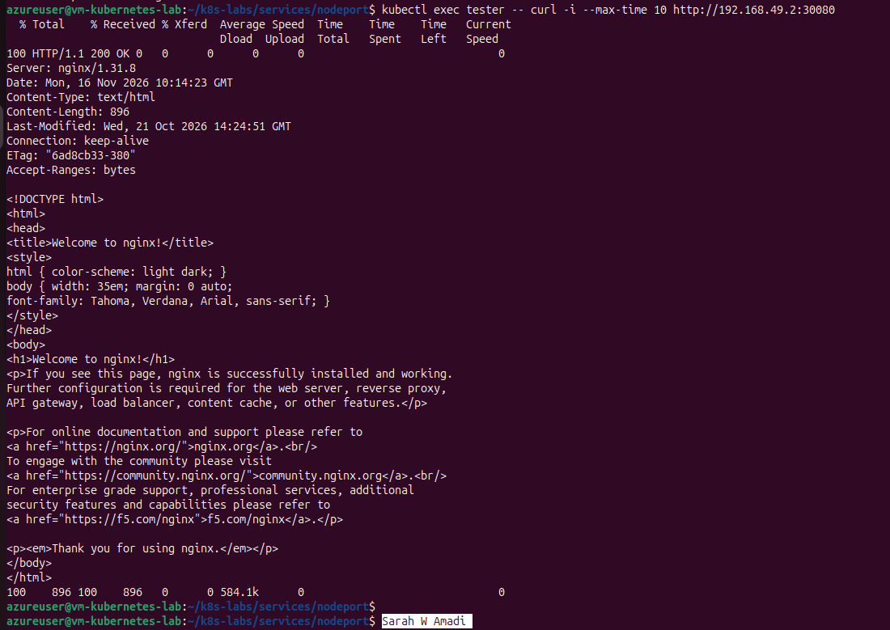>

### Notes

**1. Which node IP and NodePort did you test?**

I tested the Minikube node IP 192.168.49.2 on NodePort 30080. The NGINX NodePort Service listens on port 80 and forwards traffic to the NGINX Pods on their container port 80.

**2. Was your laptop able to reach the NodePort directly? Explain your result.**

I used an Azure-hosted Ubuntu VM running Minikube with the Docker driver. The Minikube node IP, 192.168.49.2, belongs to an internal Docker network within the Azure VM. It is not directly routable from my laptop.

Therefore, direct laptop access to this private node IP is not expected to work without additional network routing or port forwarding. I used the tester Pod inside the Kubernetes cluster to test NodePort connectivity instead.

**3. Why can external NodePort access behave differently in Minikube, kind, Docker Desktop, and cloud clusters?**

External NodePort access depends on how the Kubernetes cluster is deployed and how its networking is configured.
- Minikube: The node may run inside a VM or Docker container with a private IP. That IP might not be directly accessible from the host machine.
- kind: Kubernetes nodes run as Docker containers. NodePort access from outside the cluster may require additional port mappings or network configuration.
- Docker Desktop: Kubernetes runs within Docker Desktop's managed virtual environment. Host-to-cluster networking is integrated differently from a standalone VM or container network.
- Cloud clusters: Nodes generally run on cloud infrastructure with private or public IP addresses. Access depends on routing, firewall rules, network security groups, and cluster configuration.

---

# Task 5 — Optional: Test the Label-Selector Contract

## Goal

Break the Service selector, observe that usable endpoints disappear, and restore the correct selector.

Complete the Evidence and Notes below only if you attempted this optional task.

### Evidence

#### Screenshot 9 — `02-nginx-svc-selector-broken.yaml` showing the incorrect selector

<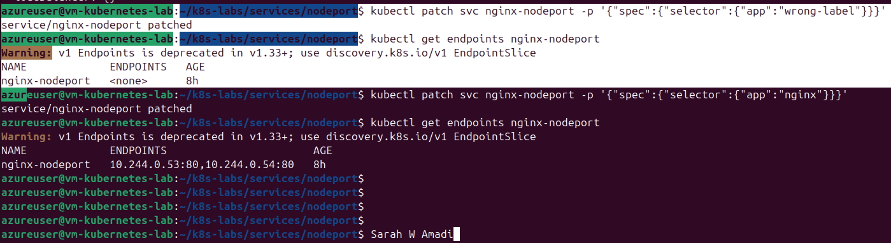>

---

#### Screenshot 10 — Empty endpoints or EndpointSlice output after applying the broken selector

<>

---

#### Screenshot 11 — Restored endpoints or EndpointSlices after applying the original Service manifest

<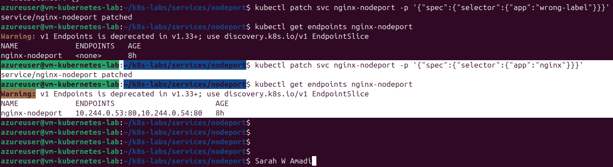>

### Notes

**1. Why did the Service endpoints become empty?**

The Service endpoints became empty because I temporarily changed the Service selector from app: nginx to app: wrong-label. Kubernetes could no longer find any Pods matching the new selector. As a result, the Service had no backend endpoints to route traffic to. The NGINX Pods remained running.

**2. Why is NodePort only useful when matching ready Pods exist?**

NodePort exposes a Service through a port on the Kubernetes node, but the Service still needs healthy, ready backend Pods to handle incoming requests. If no ready Pods match the Service selector, there are no endpoints to receive traffic, even though the NodePort remains configured.

**3. How did you restore the backend connectivity?**

I restored the original Service selector using:
`kubectl patch svc nginx-nodeport -p '{"spec":{"selector":{"app":"nginx"}}}'`

Kubernetes then identified the two matching NGINX Pods and repopulated the Service endpoints with their IP addresses and port 80.

---

# Task 6 — Observe Resilience During Pod Churn

## Goal

Delete one NGINX Pod and observe its replacement while the Service continues routing traffic to available Pods.

### Evidence

#### Screenshot 12 — Output of the Pod deletion command

<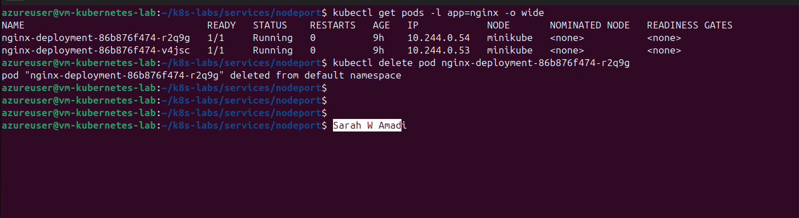>

---

#### Screenshot 13 — Output showing the replacement Pod and two running, ready Pods

<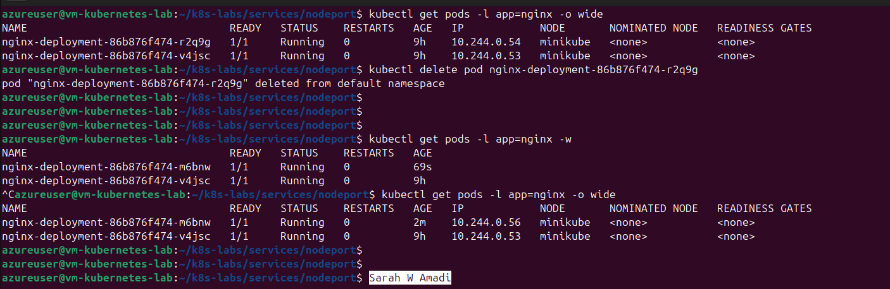>

### Notes

**1. What happened after you deleted one Pod?**

After deleting one NGINX Pod, Kubernetes detected that the Deployment had fewer than its desired two replicas. It automatically created a replacement Pod. The new Pod became ready, restoring the Deployment to two running replicas.

**2. Which Kubernetes resource created the replacement Pod?**

The ReplicaSet controller created the replacement Pod. The Deployment manages the ReplicaSet, which maintains the desired number of Pod replicas.

**3. Why can the NodePort Service continue working during Pod churn?**

The NodePort Service provides a stable network endpoint independent of individual Pod lifecycles. Kubernetes continuously updates its backend endpoints as Pods become unavailable or new Pods become ready. The remaining ready Pod can continue receiving traffic while Kubernetes creates and registers a replacement.

---

# Task 7 — Share Your NodePort Learning on LinkedIn

## Goal

Share what you learned about NodePort Services, backend Pods, and network access in your Kubernetes environment.

### Evidence

#### Screenshot 14 — Published LinkedIn post about your NodePort Service lab

<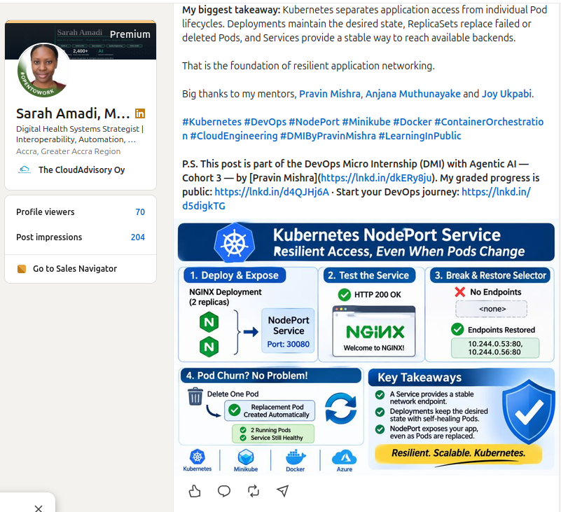>

#### Linkedin post link

https://www.linkedin.com/posts/sarah-w-amadi_kubernetes-devops-nodeport-share-7528173772915499008-KYz-/?utm_source=share&utm_medium=member_desktop&rcm=ACoAACAx4n8Bvuf305sZ28vfr5yvaoLLEr0SkSA

---

# Submission Instructions

- Include the completed YAML manifests created during the lab.
- Add all required screenshots: Screenshots 1–8 and 12–14.
- Include Screenshots 9–11 only if you attempted optional Task 5.
- Complete the Notes for Tasks 1–4 and Task 6.
- Complete Task 5 Notes only if you attempted that task.
- Use clear, readable screenshots showing the relevant commands and outputs.
- Ensure your full name is visible in the required screenshots.
- If NodePort access is restricted by your environment, include the failed request output, ready endpoint evidence, and an explanation.
- Do not expose passwords, access tokens, private keys, kubeconfig contents, or account IDs.

---

# Completion Checklist

- [ ] Created and entered `~/k8s-labs/services/nodeport` (Screenshot 1)
- [ ] Created and applied the NGINX Deployment manifest (Screenshot 2)
- [ ] Confirmed successful rollout and two ready NGINX Pods (Screenshot 3)
- [ ] Created the NodePort Service manifest (Screenshot 4)
- [ ] Verified the Service and its endpoints or EndpointSlices (Screenshot 5)
- [ ] Recorded the assigned or selected NodePort
- [ ] Identified a node IP (Screenshot 6)
- [ ] Confirmed that the `tester` Pod is running (Screenshot 7)
- [ ] Tested NodePort access, or documented the environment limitation with evidence (Screenshot 8)
- [ ] Optional: Tested and restored the Service selector (Screenshots 9–11)
- [ ] Deleted one NGINX Pod (Screenshot 12)
- [ ] Confirmed the replacement Pod and two running, ready Pods (Screenshot 13)
- [ ] Completed all required Notes
- [ ] Published the LinkedIn post (Screenshot 14)
- [ ] No sensitive data exposed

---

## 📌 About DMI & CloudAdvisory

DevOps Micro Internship (DMI) is a project-based DevOps program run by Pravin Mishra (The CloudAdvisory) focused on real-world execution, systems thinking, and career readiness.

It helps learners build strong DevOps foundations with hands-on experience.

---

## 📌 Resources

- 🌐 DMI Official Website: https://dmi.pravinmishra.com?utm_source=github&utm_medium=readme  
- 🎓 University: https://university.pravinmishra.com?utm_source=github&utm_medium=readme  
- 💬 Discord Community: https://discord.pravinmishra.com?utm_source=github&utm_medium=readme  
- 📝 Blog: https://dmi.pravinmishra.com/blog?utm_source=github&utm_medium=readme  
- ▶️ YouTube Playlist: https://www.youtube.com/playlist?list=PLFeSNDtI4Cho  
- 🔗 Pravin Mishra (LinkedIn): https://www.linkedin.com/in/pravin-mishra-aws-trainer/  
- 🏢 CloudAdvisory (LinkedIn): https://www.linkedin.com/company/thecloudadvisory/

---

*This submission is part of DevOps Micro Internship (DMI) — Agentic AI Track.*
