# Assignment 10 — Capstone: Deploy the Book Review App to Kubernetes

Part of the DevOps Micro Internship (DMI) with Agentic AI

---

## Purpose

Deploy the Book Review App as a production-style three-tier application using Kubernetes manifests or Helm charts, with an accessible frontend, an internal backend, and a managed or persistent MySQL database.

---

## Submission Details

**Full Name:** Sarah W Amadi.

**Kubernetes Platform:** Microsoft Azure Kubernetes Service (AKS)

**Namespace:** book-review

**Frontend URL or IP:** http://20.22.39.50

**Access Method:** Public Kubernetes LoadBalancer Service exposing the frontend on port 80. Backend and MySQL services remain accessible internally through ClusterIP Services.

**GitHub Manifests or Helm Chart URL:** https://github.com/sarah254-tech/book-review-app

**Architecture Diagram:** Three-tier Book Review application architecture on AKS, illustrating the Next.js/Nginx frontend, Node.js/Express backend, MySQL StatefulSet, Kubernetes Services and persistent storage. See attached architecture diagram.

<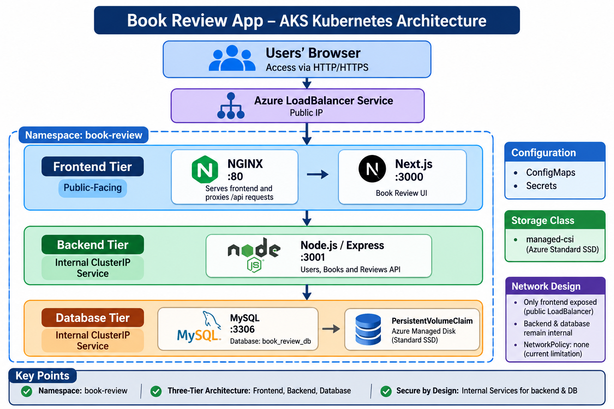>

---

# Task 1 — Prepare the Kubernetes Cluster and Project

## Goal

Prepare the cluster, application source, container images, and tooling needed for the deployment.

### Evidence

#### Screenshot 1 — Active Kubernetes context and Ready nodes

<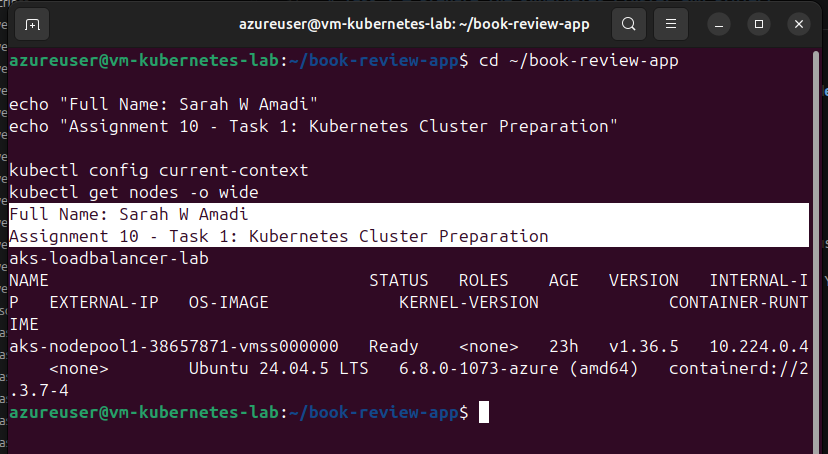>

---

#### Screenshot 2 — If using Helm: Output of `helm version`

Required only if you choose Helm. Skip this screenshot if using YAML manifests.

Not applicable — using YAML manifests.

---

# Task 2 — Design the Three-Tier Kubernetes Architecture

## Goal

Document the workloads, networking, configuration, storage, and permitted communication paths before deployment.

### Evidence

#### Screenshot 3 — Completed Kubernetes architecture diagram

<>

---

# Task 3 — Create ConfigMaps and Secrets

## Goal

Provide application configuration and credentials without embedding sensitive values in images or committing them to Git.

### Evidence

#### Screenshot 4 — ConfigMap configuration or describe output showing non-sensitive values

<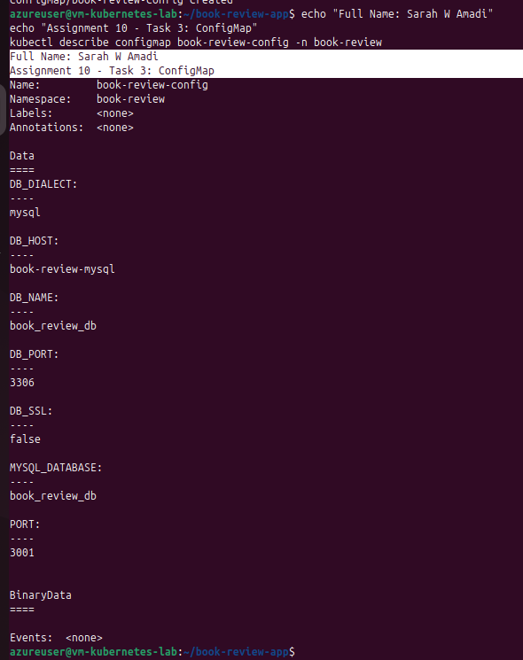>

---

#### Screenshot 5 — Secret references or describe output showing names and keys without sensitive values

<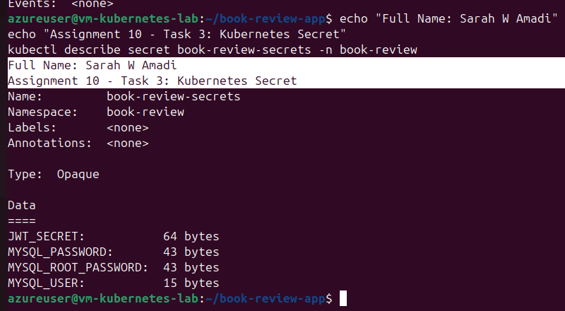>
---

# Task 4 — Deploy and Configure the MySQL Data Tier

## Goal

Provide persistent MySQL storage and allow the backend to connect without exposing the database publicly.

### Evidence

#### Screenshot 6 — Managed MySQL status or MySQL StatefulSet and PVC status

<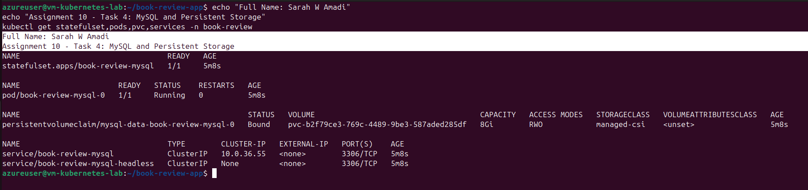>

---

#### Screenshot 7 — Successful database connectivity or schema verification with credentials hidden

<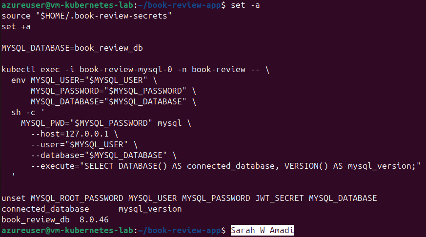>

---

# Task 5 — Deploy the Backend Application Tier

## Goal

Run one or two Node.js/Express backend replicas on port 3001 and expose them through an internal ClusterIP Service.

### Evidence

#### Screenshot 8 — Backend Deployment, ready Pods, and internal Service

<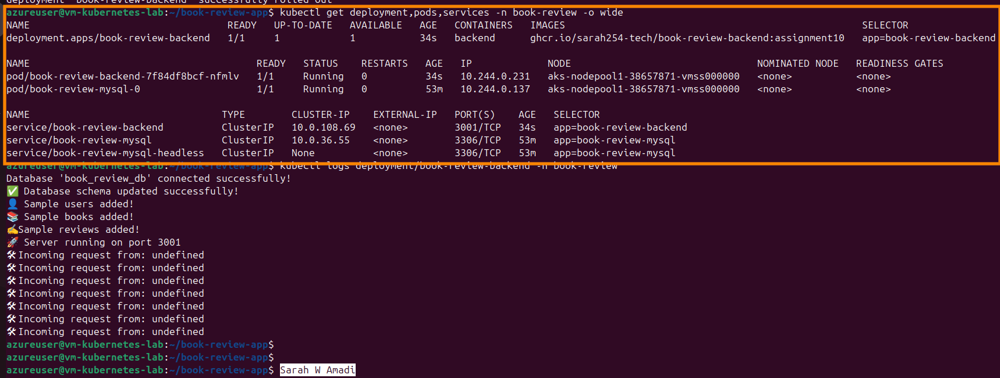>

---

#### Screenshot 9 — Backend startup logs and database connectivity evidence

If the application does not log successful database connections, provide a successful database-backed request alongside the startup logs.

<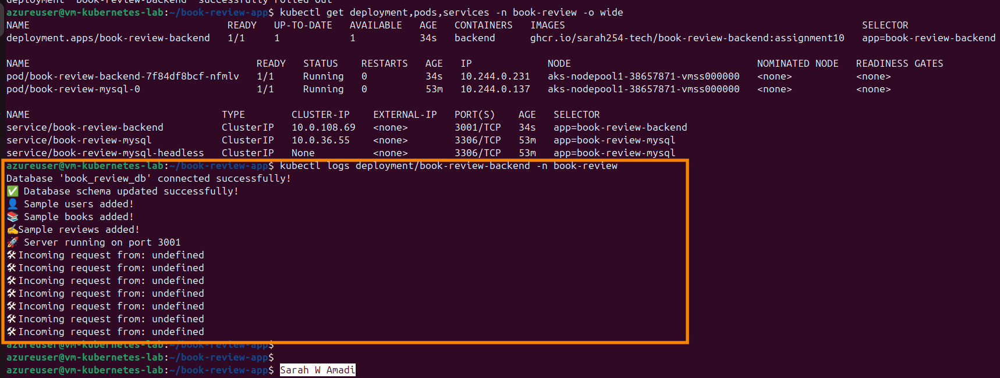>

---

# Task 6 — Deploy the Frontend and Configure Nginx

## Goal

Run the Next.js frontend behind Nginx on port 80 and proxy API requests to the internal backend Service.

### Evidence

#### Screenshot 10 — Frontend Deployment and Ready Pods

<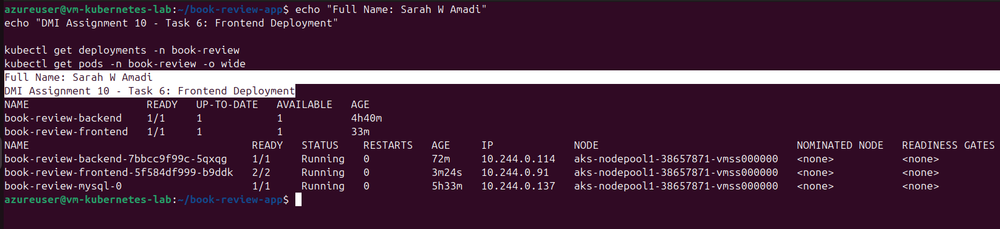>

---

#### Screenshot 11 — Nginx reverse-proxy configuration showing the internal backend Service name and port 3001

<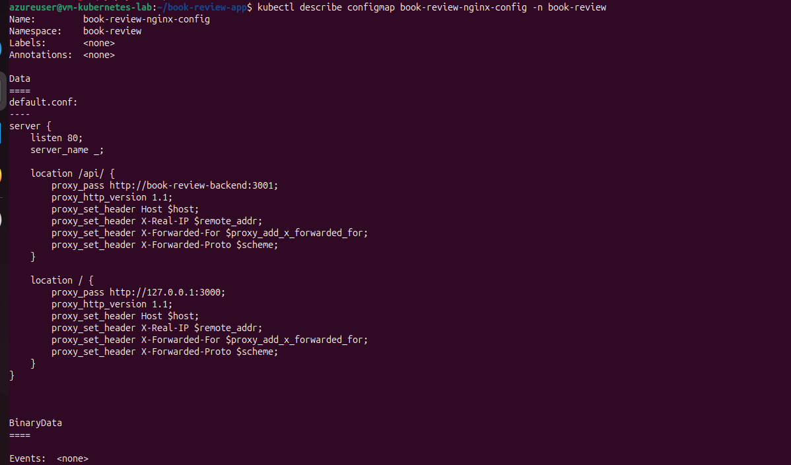>
---

# Task 7 — Configure External and Internal Networking

## Goal

Expose the frontend and enforce the intended communication path between application tiers.

### Evidence

#### Screenshot 12 — Frontend LoadBalancer or Ingress configuration and assigned endpoint, or documented local access method

<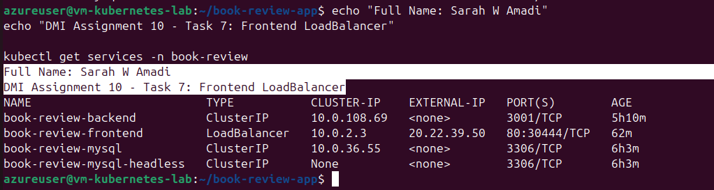>

---

#### Screenshot 13 — Internal backend Service and NetworkPolicy or equivalent restriction, with access-test evidence

<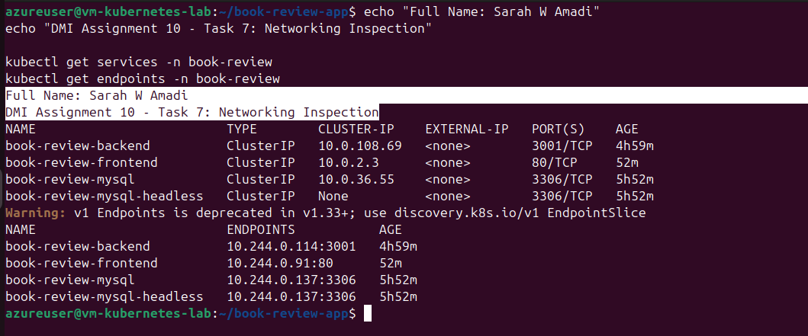>

---

# Task 8 — Validate the Application End to End

## Goal

Prove that the frontend, backend, and MySQL database work together and collect operational evidence.

### Evidence

#### Screenshot 14 — `kubectl get all` output for the book-review namespace

<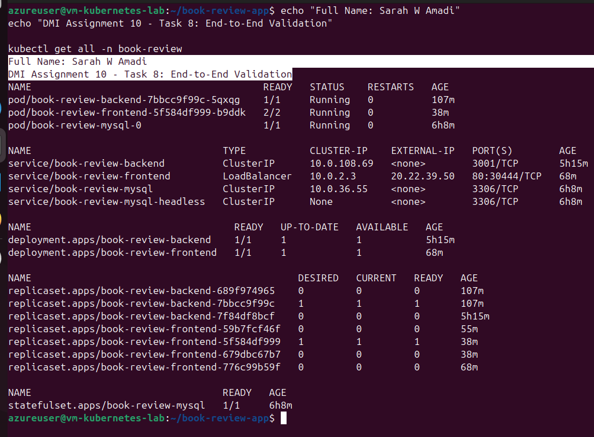>

---

#### Screenshot 15 — Functional Book Review App in the browser with the URL visible, including evidence of a successful user flow

<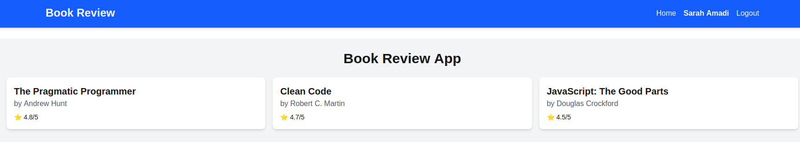>

---

#### Screenshot 16 — Frontend or Nginx container logs

<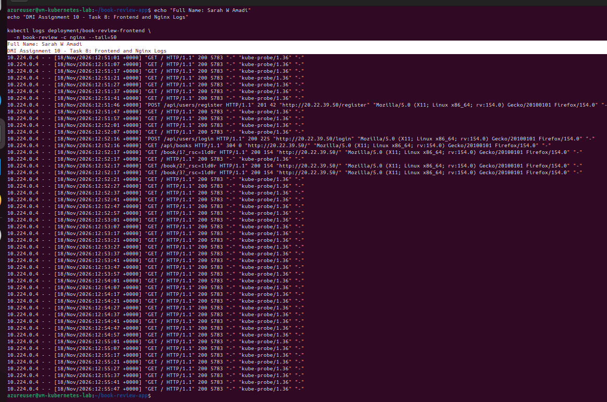>

---

#### Screenshot 17 — Backend logs and evidence of a successful database-backed operation

<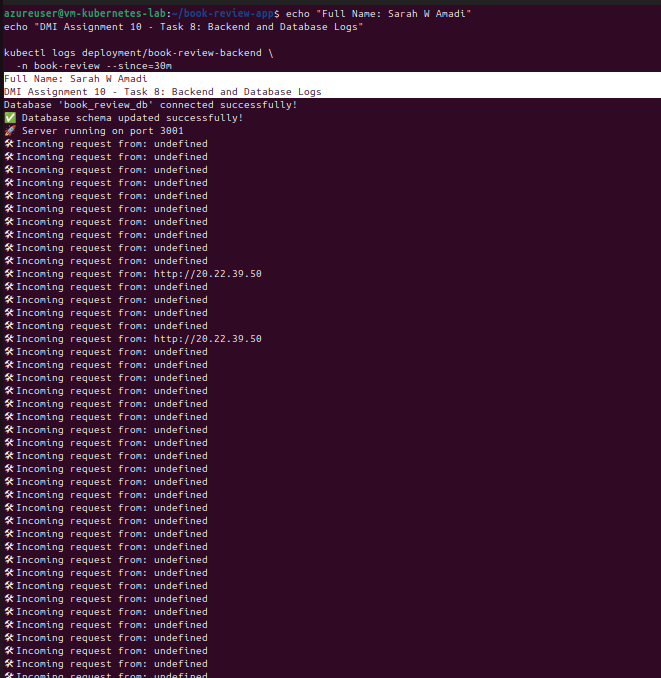>

---

#### Screenshot 18 — Optional: Kubernetes dashboard

 Not attempted.

Multiple images may be included under a screenshot number when needed to demonstrate the complete user flow.

---

# Task 9 — Optional: Implement Production Improvements

## Goal

Add selected improvements without breaking the required three-tier architecture.

### Evidence

#### Screenshot 19 — Optional: Evidence of selected Helm, HPA, probe, or TLS improvements

Not attempted. Existing deployment includes health probes, resource requests and limits, persistent storage, ConfigMaps and Secrets.

---

# Task 10 — Publish Your Book Review App Deployment on LinkedIn

## Goal

Explain your three-tier architecture, demonstrate the working application, and share what you learned.

### Evidence

#### Screenshot 20 — Published LinkedIn post about your Book Review App deployment on Kubernetes

<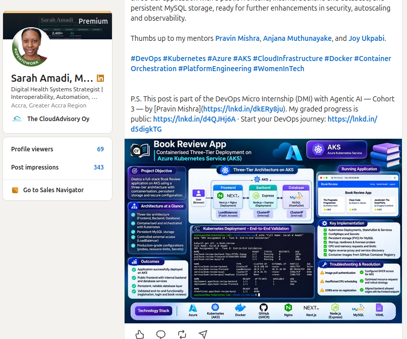>

### LinkedIn Post URL

https://www.linkedin.com/posts/sarah-w-amadi_devops-kubernetes-azure-share-7528820308997492736-G4XI/?utm_source=share&utm_medium=member_desktop&rcm=ACoAACAx4n8Bvuf305sZ28vfr5yvaoLLEr0SkSA

---

# Final Summary

## What Worked

Successfully deployed a full-stack Book Review application on Microsoft Azure Kubernetes Service (AKS) using a three-tier architecture.

The deployment consists of:
- **Frontend:** Next.js application served through Nginx, exposed publicly through a Kubernetes LoadBalancer Service.
- **Backend:** Node.js and Express REST API deployed internally through a ClusterIP Service.
- **Database:** MySQL deployed using a StatefulSet with persistent storage provisioned through a PersistentVolumeClaim.

Implemented Kubernetes Deployments, StatefulSets, Services, ConfigMaps, Secrets, health probes, resource requests and limits, and persistent storage.

Validated application availability through the public frontend endpoint (`http://20.22.39.50`), confirmed successful user authentication and book listing functionality, and verified that the backend and database services remained internally accessible.

## Issues and Fixes

Several infrastructure and application-level issues were identified and resolved during implementation:

- **Container image authentication:** Resolved GitHub Container Registry image-pull failures by configuring the container packages for public access and verifying anonymous image pulls.
- **Insufficient CPU scheduling:** Investigated a Pending frontend Pod caused by insufficient node CPU capacity during a rolling update and adjusted container resource requests to enable successful scheduling.
- **CORS configuration:** Diagnosed registration failures caused by the backend rejecting the public frontend origin and configured the `ALLOWED_ORIGINS` environment variable in the Kubernetes Deployment.
- **Application validation:** Used Kubernetes events, deployment configurations and application logs to distinguish infrastructure health from actual application functionality.

The project reinforced the importance of systematic troubleshooting across infrastructure, networking and application layers.

## Tools and Sources Used

**Cloud and Infrastructure**
- Microsoft Azure
- Azure Kubernetes Service (AKS)
- Azure Managed Disks

**Containerisation and Orchestration**
- Docker
- Kubernetes
- Kubernetes YAML manifests
- GitHub Container Registry (GHCR)

**Application Stack**
- Next.js
- Node.js
- Express.js
- MySQL
- Nginx

**Configuration and Validation**
- ConfigMaps and Secrets
- PersistentVolumes and PersistentVolumeClaims
- Kubernetes Deployments, StatefulSets and Services
- Startup, readiness and liveness probes
- `kubectl` for deployment management, troubleshooting and validation
- Azure CLI for Azure resource management
- Git and GitHub for source control

**Documentation and References**
- Kubernetes official documentation: https://kubernetes.io/docs/
- Microsoft AKS documentation: https://learn.microsoft.com/azure/aks/
- Docker documentation: https://docs.docker.com/
- Nginx documentation: https://nginx.org/en/docs/

## Optional Improvements

Additional production enhancements were not implemented as part of this deployment.

Potential next steps include:
- HTTPS/TLS termination for secure external communication.
- Horizontal Pod Autoscaling (HPA).
- Kubernetes NetworkPolicies for stronger workload isolation.
- Centralised monitoring and logging using Prometheus, Grafana and Loki.
- Automated CI/CD pipelines for application builds and Kubernetes deployments.
- Ingress-based traffic management.

The current implementation provides a foundation for these enhancements.

## Cleanup or Reuse Plan

**Environment retained for reuse.**

The AKS cluster, Kubernetes namespace, application workloads, LoadBalancer Service, persistent MySQL storage and supporting Azure resources have been retained for continued testing, demonstration and future improvements.

No destructive cleanup has been performed.

The environment will be reused for further Kubernetes exercises, production-readiness enhancements and CI/CD integration. Azure resource costs will be monitored while the environment remains active.

---

# Submission Instructions

- Include your Kubernetes manifests or Helm chart in the linked repository.
- Submit Secret examples containing placeholders only.
- Include Screenshot 1, Screenshots 3–17, and Screenshot 20.
- Include Screenshot 2 only if using Helm.
- Screenshots 18–19 are optional.
- Keep screenshot numbering consistent with the guidelines.
- Use clear, readable screenshots showing relevant configuration, commands, and outputs.
- Make your full name visible in required screenshots.
- Complete the submission details and Final Summary.
- Include your published LinkedIn post URL.
- Capture required evidence before cleanup.
- Do not expose passwords, tokens, JWT secrets, actual Secret values, kubeconfig contents, cloud credentials, or confidential account information.

---

# Completion Checklist

- [ ] Selected and configured a supported Kubernetes platform
- [ ] Confirmed the context and Ready nodes (Screenshot 1)
- [ ] Created and selected the book-review namespace
- [ ] Inspected the application repository
- [ ] Prepared images accessible to the cluster
- [ ] Confirmed Helm if using charts (Screenshot 2, conditional)
- [ ] Created the architecture diagram (Screenshot 3)
- [ ] Created ConfigMaps and Secrets (Screenshots 4–5)
- [ ] Excluded actual Secret values from Git and screenshots
- [ ] Provisioned private managed MySQL or persistent Kubernetes MySQL (Screenshot 6)
- [ ] Initialized the required database and schema
- [ ] Verified database connectivity or schema (Screenshot 7)
- [ ] Deployed one or two backend replicas listening on port 3001
- [ ] Created the backend ClusterIP Service (Screenshot 8)
- [ ] Verified backend-to-database connectivity (Screenshot 9)
- [ ] Deployed one or two frontend replicas behind Nginx (Screenshot 10)
- [ ] Configured API proxying through the internal backend Service (Screenshot 11)
- [ ] Configured and documented frontend access (Screenshot 12)
- [ ] Enforced backend access restrictions (Screenshot 13)
- [ ] Confirmed that the backend and database are not publicly exposed
- [ ] Captured resource status for book-review (Screenshot 14)
- [ ] Tested application functionality and database writes (Screenshots 15 and 17)
- [ ] Verified saved data after application restart
- [ ] Captured frontend and backend logs (Screenshots 16–17)
- [ ] Included optional dashboard or improvement evidence if attempted (Screenshots 18–19)
- [ ] Published the LinkedIn post (Screenshot 20)
- [ ] Included the LinkedIn post URL
- [ ] Documented issues, fixes, and useful sources
- [ ] Recorded cleanup status or reuse plans
- [ ] No sensitive data exposed

---

## 📌 About DMI & CloudAdvisory

DevOps Micro Internship (DMI) is a project-based DevOps program run by Pravin Mishra (The CloudAdvisory) focused on real-world execution, systems thinking, and career readiness.

It helps learners build strong DevOps foundations with hands-on experience.

---

## 📌 Resources

- 🌐 DMI Official Website: https://dmi.pravinmishra.com?utm_source=github&utm_medium=readme  
- 🎓 University: https://university.pravinmishra.com?utm_source=github&utm_medium=readme  
- 💬 Discord Community: https://discord.pravinmishra.com?utm_source=github&utm_medium=readme  
- 📝 Blog: https://dmi.pravinmishra.com/blog?utm_source=github&utm_medium=readme  
- ▶️ YouTube Playlist: https://www.youtube.com/playlist?list=PLFeSNDtI4Cho  
- 🔗 Pravin Mishra (LinkedIn): https://www.linkedin.com/in/pravin-mishra-aws-trainer/  
- 🏢 CloudAdvisory (LinkedIn): https://www.linkedin.com/company/thecloudadvisory/

---

*This submission is part of DevOps Micro Internship (DMI) — Agentic AI Track.*
